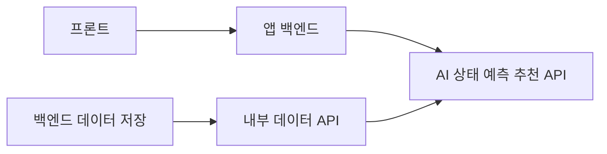
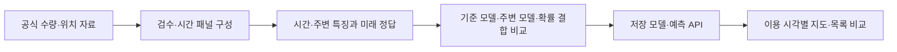

# CycleOn 모델 API 협업

서울 따릉이의 **목표 정각 0대 위험**을 1·2·3시간 간격으로 예측하고, 현재 수량과 거리를 함께 비교하는 서비스다.

**백엔드·프론트 개발자는 이 페이지와 [빠른 시작](모델개발/docs/cycleon/QUICKSTART.md)에서 시작한다.** 모델·연구 데이터·공공 API 키 없이 목업을 실행하고 같은 API 규격으로 개발할 수 있다.

## 처음 실행하기

Git과 Python 3.12를 준비한다. Windows PowerShell에서:

```powershell
git clone --depth 1 https://github.com/Honggyu-Chun/seoul-bike-risk-forecast.git
cd seoul-bike-risk-forecast
git switch -c feature/my-integration
.\SETUP_CYCLEON_MOCK.cmd
.\RUN_CYCLEON_MOCK.cmd
```

설치 명령은 `모델개발/.venv-contract`를 만들고 계약 검사 33개를 실행한다. 실행 파일의 토큰 `local-mock-only-change-this-token-123456`은 로컬 목업 전용 공개 예시다. 실행 후 <http://127.0.0.1:18011/docs>에서 Bearer 토큰을 입력해 호출한다. 주소는 본인 PC이며 목업의 시각·확률은 합성값이다.

두 번째 터미널에서 `모델개발`로 이동해:

```powershell
$env:CYCLEON_MOCK_TOKEN = 'local-mock-only-change-this-token-123456'
.\.venv-contract\Scripts\python.exe scripts/cycleon_http_check.py
```

Linux/macOS 명령과 실제 호출 예시는 [빠른 시작](모델개발/docs/cycleon/QUICKSTART.md)에 있다. Windows에서는 루트 `SETUP_CYCLEON_MOCK.cmd`, `RUN_CYCLEON_MOCK.cmd`도 사용할 수 있다.

## 담당별 개발 시작점

| 담당 | 읽을 내용 | 지금 개발할 수 있는 것 |
| --- | --- | --- |
| 백엔드 | [백엔드 인수 명세](모델개발/docs/cycleon/BACKEND_HANDOFF.md), [파트 간 계약](모델개발/docs/cycleon/INTEGRATION_CONTRACT.md) | 데이터 저장·내부 API, AI 호출 중계, 대여소 목록, 인증·예외 처리 |
| 프론트 | [프론트 명세](모델개발/docs/cycleon/FRONTEND_HANDOFF.md), [API 레퍼런스](모델개발/docs/cycleon/API_REFERENCE.md) | 위치·목표 정각·지도·목록·위험·추천과 보류 화면 |
| 모델 | [모델 상태](모델개발/docs/cycleon/MODEL_STATUS.md), [실모델 인수](모델개발/docs/cycleon/REAL_MODEL_HANDOFF.md) | 번들·특징·보정·정책 검증과 AI 런타임 연결 |
| QA | [빠른 시작](모델개발/docs/cycleon/QUICKSTART.md), [합성 예시](모델개발/docs/cycleon/mock_examples.json) | 성공·보류·미준비, 인증·입력 오류·null·시간대 검증 |

기계 명세는 [AI OpenAPI](모델개발/docs/cycleon_ai_openapi.json)와 [내부 데이터 OpenAPI](모델개발/docs/cycleon_backend_openapi.json)다. [Postman](모델개발/docs/cycleon/CycleOn.postman_collection.json)과 [Node 서버 호출 예제](모델개발/examples/cycleon_backend_client.mjs)를 제공한다.

## 연결 경계



프론트는 앱 백엔드만 호출한다. 대여소 ID·이름·좌표 목록은 앱 백엔드가 제공하며 AI 예측 응답의 ID로 연결한다. 사용자 조회에는 대여소 ID·간격 또는 위치·반경을 보낸다. 재고 이력·기상은 별도 내부 데이터 API로 동기화하고 AI가 학습과 같은 특징을 만든다.

앱의 공개 API 경로·사용자 인증·갱신 주기는 팀이 합의할 항목이다. 기존 AI의 요청·응답 의미와 타입은 유지한다. 상세 결정 항목과 고정 규칙은 [파트 간 계약](모델개발/docs/cycleon/INTEGRATION_CONTRACT.md)에 모았다.

## 모델과 실제 접속 상태

2026-11-02 기준 기존 기반 모델은 **22개 설정·44회 적합**이며, 후속 신경망·결합·보정 연구와 그 적합 횟수는 별도로 기록한다. 64개를 채우는 조건은 폐기했다. 후속 4차 비교까지 최종 채택·운영 교체는 없고 최종 모델·추천 정책·독립 평가가 남아 있다.

개발용 실모델 번들 `development_TC_20261027_v2`에는 T/C LightGBM 세 간격이 있다. **가중치·실제 데이터·키·DB는 Git에 포함되지 않는다.** 이 저장소만으로 목업 기반 개발은 가능하며, 실제 모델 추론에는 별도 번들 또는 접속 인수가 필요하다. [실모델 인수 절차](모델개발/docs/cycleon/REAL_MODEL_HANDOFF.md)를 따른다.

11월 2일 접속 확인에서는 새 AI 8001·데이터 8002가 미가동이었다. `127.0.0.1:18011` 목업 주소와 공용 실서버 주소를 혼동하지 않는다. S/C는 연동 후보 제안이며 현재 제공 번들·최종 선정본과 다르다. 연구 현황은 [모델 상태](모델개발/docs/cycleon/MODEL_STATUS.md)를 기준으로 읽는다.

## 협업 중 변경하기

각자 `feature/`, `fix/`, `model/`, `data/`, `docs/` 등의 작업 브랜치를 사용한다. [CONTRIBUTING](CONTRIBUTING.md)의 계약 변경·로컬 확인 절차를 따른다. API를 바꾸면 코드·OpenAPI·예시·호출 측을 같이 수정하며, GitHub Actions가 모델 없는 계약 검사를 실행한다.

## 이전 시제품과 연구 기록

아래는 이전 제안·시제품·연구 설명이다. 과거 날짜의 계획·성과는 현재 운영 상태가 아니다. 신규 1~3시간 연동은 위 빠른 시작을 따른다. 기존 `SETUP_P_PROJECT.cmd`와 8000은 이전 1시간 시제품용이다.

**사용자 지정 시각의 따릉이 부족 위험 예측 및 대여소 선택 지원**

따릉이를 이용하려는 시민이 **이용 예정 시각의 자전거 부족 위험과 이동 거리**를 함께 비교하도록 돕는 AI 프로젝트를 개발한다. 현재 수량을 확인한 뒤 이동하는 동안 대여·반납으로 상황이 달라지는 문제에 주목한다. 사용자가 선택한 위치와 이용 시각을 기준으로 주변 대여소의 수량·0대 위험·직선거리를 지도와 목록에 제시한다.

가천대학교 AI P-실무프로젝트의 팀 **CycleOn**이 수행한다. 수행 기간은 **2026.9.1~2026.12.21**로 한다. 프로젝트 범위는 담당자가 보관한 최신 제출 과제제안서를 기준으로 설명한다. 제출 원본은 로컬 자료이며 이번 협업 초안에 원본 바이너리를 새로 올리지 않는다.

## 최신 제출 자료와 개발 기준 — 2026-10-26

노트북의 `사전발표제출` 폴더에서 받은 10월 27일 발표용 자료 4개를 원본 해시 그대로 반영했다. 제출 계획서는 10월 25일 01:13, PPT는 13:28, PDF는 14:04에 수정된 파일이다(KST). 이 날짜는 발표일·개발 완료일과 구분한다.

- 제출 계획서: 로컬 `사전발표제출/`의 CycleOn 과제계획서 DOCX
- 발표 PPT·PDF: 로컬 동일 폴더의 각각 18슬라이드·18페이지
- 발표 영상 링크·자료 비교: 로컬 동일 폴더의 링크 TXT·`최신자료_조사결과_20261026.txt`

`과제제안서`의 기존 작성본 경로도 제출 계획서와 같은 내용으로 갱신했다. 직전 근거통합본은 `과제제안서/이전작성본`에 보존한다. 제출본은 내부 실험 참고문헌 [17]을 삭제한 버전이며, 필요성 통계와 성능의 재현 근거는 기존 v4 보고서 및 아래 연구 기록에서 확인한다.

새 서비스 연결 담당자는 **[CycleOn 빠른 시작](모델개발/docs/cycleon/QUICKSTART.md)**을 따른다. 기존 8000 시제품을 실행할 때만 [기존 첫 실행 안내](모델개발/docs/TEAM_SETUP.md)와 `SETUP_P_PROJECT.cmd`·`START_P_PROJECT.cmd`를 사용한다. 모델 담당자의 연구 환경 준비는 `SETUP_P_PROJECT.cmd research`다.

## 해결하려는 문제

현재 자전거가 있는 대여소도 이용자가 도착할 때는 비어 있을 수 있다. 가까운 대여소의 수량만으로 판단하기 어려운 상황에서, **같은 이용 예정 시각의 부족 위험과 거리**를 함께 비교하는 선택 도구를 제안한다.

- **이용자:** 따릉이를 빌리기 위해 주변 대여소를 고르는 시민으로 설정한다.
- **예측 대상:** 기준 시각에서 1·2·3시간 뒤, 정확한 시간 격자에 기록된 수량이 0대일 확률로 정의한다.
- **선택 지원:** 기준 시각 수량, 예정 시각의 부족 위험, 직선거리를 함께 제시한다.
- **기대효과:** 반복 검색과 불필요한 이동 부담을 줄일 가능성을 검토한다. 실제 대여 성공과 시간 절감은 별도 검증으로 확인한다.

예를 들어 14시 자료를 기준으로 15시·16시·17시 중 이용 시각을 선택하고 모든 후보를 동일한 예정 시각에 맞춰 비교하도록 설계한다. 실제 대여 성공이나 한 시간 내내 자전거가 남아 있다는 보장과는 구분한다.

## 주요 기능과 개발 범위

| 기능 | 제안서 기준 개발 내용 |
| --- | --- |
| 위치·시각 선택 | 실시간 조회를 주 기능으로 두고 위치와 지원하는 1·2·3시간 뒤 목표 정각을 선택한다. 과거 날짜·기준 시각 선택은 평가·발표용 재현 화면으로 구분한다. |
| AI 부족 위험 예측 | 예정 시각의 0대 확률을 대여소별로 계산한다. |
| 대여소 비교 | 지도·목록에서 기준 수량, 위험과 직선거리를 비교한다. |
| 후보 추천 | 같은 후보 집합에서 위험과 거리의 균형을 고려해 순서를 제시한다. |
| 예외 처리 | 자료 누락, 이력 부족, 후보 없음과 지원 범위 밖 시각을 구분해 안내한다. |
| 결과 검증 | 기준 모델·주변 정보 모델·확률 결합과 단순 추천 규칙을 같은 조건에서 비교한다. |

## AI 개발 방법

공개 학습기인 **LightGBM·CatBoost**를 활용하고, 자체 개발 범위를 자료 구성·특징 설계·모델 결합·검증·서비스 연결로 구체화한다.

1. 대여소별 시간 패널에서 현재 수량, 최근 증감, 전일·전주 같은 시각의 패턴과 요일·시간대를 구성한다.
2. 기준 시각 이전의 정보만 이용해 1·2·3시간 뒤 정답을 각각 구성한다.
3. 자기 대여소 이력만 쓰는 시간 특징 모델을 기준으로 비교한다.
4. 반경 500m 수량·0대 비율과 가까운 5개 대여소의 변화 등 주변 정보를 더한다.
5. 주변 특징 모델에 현재 기상 실황을 더한 W와, 기준 시각 전에 발표된 목표 시각 예보를 더한 F를 각각 비교한다. W와 F는 S(주변 추가)를 공통 대조군으로 하는 별도 입력 실험이다.
6. 같은 입력·표본에서 LightGBM, CatBoost, 두 모델 확률의 50:50 평균을 비교하고 검증 성능으로 선택한다. 학습 행은 대여소·기준 정각 t·간격 h이며, h=1·2·3을 포함한 공통 모델을 개발할 계획이다.

같은 입력을 쓰는 학습기 비교와 입력 정보를 추가하는 비교를 구분한다. 누락 관측을 실제 0대로 채우지 않으며 대치·보정·임계값 선택에는 정해진 과거 구간만 사용한다.



위 구조는 최신 제안서의 개발 방향을 나타낸다. 현재 구현한 실험 범위는 아래에서 별도로 구분한다.

## 데이터

| 자료 | 활용 계획과 주의점 |
| --- | --- |
| [따릉이 시간별 대여가능 수량 · OA-22382](https://data.seoul.go.kr/dataList/OA-22382/F/1/datasetView.do) | 2022~2025년 16개 분기 전체를 대상으로 검수·학습·평가를 확장할 계획으로 한다. 이 범위의 학습 완료를 의미하지 않는다. |
| [따릉이 대여소 정보 · OA-13252](https://data.seoul.go.kr/dataList/OA-13252/F/1/datasetView.do) | 보유한 2024년 12월·2025년 6월 자료의 번호·이름·좌표를 대조한다. 과거 위치가 불명확하면 현재 좌표를 소급하지 않는다. |
| [실시간 수량 · OA-15493](https://data.seoul.go.kr/dataList/OA-15493/A/1/datasetView.do) | 현재 재고·수신 시각을 저장하고 정각 이력으로 연결할 계획이다. 최신 재고와 모델 기준 정각의 재고를 구분한다. |
| 기상 실황·목표 시각 예보 | 수신·발표·유효 시각을 구분하고 기준 시각까지 이용 가능한 입력만 사용한다. 미래 실제 관측을 예보 입력으로 사용하지 않는다. |
| 추가 공공데이터 | 교통·인구·행사·공간·환경 후보를 검토한다. 영향 가설과 공개 시점·수신 지연·대여소 연결을 확인한 뒤 연계한다. |

개인별 이동기록은 다루지 않으며 화면에서 입력한 위치를 별도 보관하지 않는 방향으로 설계한다. 원본 자료와 외부 코드의 출처·이용조건을 각각 확인한다.

## 검증 계획과 목표

시간 특징 LightGBM·CatBoost 중 검증 평균 F1이 높은 단일 모델을 주 기준으로 고정한다. 상태 유지 규칙, 주변 정보 추가 모델과 확률 결합도 같은 기간·대여소·표본에서 비교한다.

| 항목 | 목표와 측정 기준 |
| --- | --- |
| 예측 성능 | 기본 목표는 최우수 단일 시간 기준 대비 간격별·평균 F1 개선 및 평균 차이의 7일 블록 95% 구간 하한 > 0이다. **평균 +5%p**는 도전 목표로 구분한다. |
| 상태 변화 포착 | 현재 양수→목표 0대 구간의 재현율을 기준 이상으로 유지하는 것을 목표로 한다. 정밀도·오경보와 현재 1~3대 구간도 확인한다. |
| 추천 유효율 | 목표 시각에 1대 이상인 추천 수/전체 요청 수로 계산한다. 보류·정답 누락은 성공에 포함하지 않는다. |
| 이동 부담 | 최근접 후보 대비 평균 추가 **직선거리 100m 이내**를 목표로 한다. 추천 건수·보류율도 기록한다. |
| 조회 응답 | 모델 로딩 후 동일 PC 조회 100회의 **p95 2초 이내**를 목표로 한다. 초기 로딩을 별도 기록한다. |
| 기능 동작 | 위치·시각 선택, 후보 비교, 범위 밖 시각, 자료 누락, 후보 없음의 5개 흐름을 확인한다. |

위 수치는 제안서의 개발 목표로 제시한다. 달성한 성과와 구분하며 +5%p를 상대 증가율 5%로 바꾸어 설명하지 않는다. 계획서의 시간순 분할은 2022~2024년 학습, 2025년 1~6월 검증, 7~12월 최종 평가다. 기존에 확인한 상반기는 개발·검증 기간이며, 하반기는 이번 동기화에서도 열거나 평가하지 않았다. 모델·보정기·h별 임계값·추천 정책을 고정한 뒤 이후 기간을 평가한다. 이미 확인한 기간을 새 독립 시험으로 제시하지 않는다.

## 현재 구현 상태

| 구분 | 2026-10-26 문서 반영 기준 상태 |
| --- | --- |
| 기존 시제품 | 현재 수량·다음 1시간 위험·거리 비교용 웹 화면과 FastAPI를 보유한다. 지도 재생·결과표·실시간 표본의 모델 범위는 서로 구분한다. |
| 후속 연구 | 2025년 상반기 2,729개 대여소의 **1시간 뒤 0대 예측**에서 기존 비교 53건과 추가 자료 비교 9건을 수행한다. 규칙·변형·기간별 비교를 포함한 건수로 설명한다. |
| 최신 제안서의 확장 | **2022~2025년 자료 활용 및 1·2·3시간 이용 시각 선택**은 개발 중이다. T/C 개발 모델 호출은 확인했으나 전체 실험·최종평가·추천·운영 검증은 미완료다. 기존 1시간 결과를 새 범위의 성과로 옮겨 쓰지 않는다. |

제출 PPT의 예비 성능 표는 기존 v4의 M2 50:50 결합 **F1 73.831%, 전환 재현율 25.41%**를 사용한다. PPT 표의 시간 LightGBM 73.158%와 최초 기본 LightGBM 72.667%는 서로 다른 비교 후보다.

추가 v7 연구는 같은 A/B/C 개발 기간에서 최고 F1 **74.255%**로 최초 기본 LightGBM 대비 **+1.588%p**, M2 대비 **+0.424%p**, 직전 v6 최고 대비 **+0.170%p**였다. 해당 후보의 전환 재현율은 **25.092%**로 M2보다 **0.317%p 낮았다**. 균형 후보는 F1 **74.147%**, 전환 재현율 **26.290%**였다. 누수 진단 점수는 이 성과에 포함하지 않는다. v7은 독립 최종 시험이나 운영 채택 결과가 아니며, 제출 PPT의 수치를 바꾸지 않았다.

v7 최종 보고서는 담당자의 로컬 `모델개발/experiments/20261023_최대데이터와누수진단/실험보고서.html`에 보존한다. 기존 v4·v6·v7은 모두 1시간 예측 연구이며, 1~3시간 공통 모델과 실시간 추천 서비스의 개발 완료로 해석하지 않는다.

- [쉬운 E2E 분석 보고서](모델개발/experiments/20261020_후속실험_v4/쉬운보고서.md)에서 처리 근거·전체 비교·오류·한계를 확인한다.
- [공공데이터 조사 보고서](모델개발/experiments/20261020_공공데이터추가조사2/공공데이터_추가조사_통합보고서.md)에서 62개 후보와 인증·지연 조건을 확인한다.
- [추가 자료 비교 CSV](모델개발/experiments/20261020_추가공공데이터적용/추가자료_각기준모델대비.csv)에서 버스·대여반납 특징의 실제 결과를 확인한다.

## 저장소 구조

```text
.
├─ README.md                  프로젝트 목적·범위·현재 상태
├─ CONTRIBUTING.md            협업 절차와 실험 기록 원칙
├─ 사전발표제출/               담당자 로컬 제출 원본(협업 패키지 제외)
├─ 과제제안서/                 제출본과 동기화한 학교 양식 DOCX
└─ 모델개발/                   Python 프로젝트 실행 위치
   ├─ cycleon/                새 1~3시간 API·런타임·계약 모의 환경
   ├─ bike_demo/              기존 1시간 시제품·연구
   ├─ config/                 실험 설정
   ├─ data/                   출처·다운로드 명세
   ├─ artifacts/              가벼운 성과·검수 기록
   ├─ experiments/            실험 계획·표·시각화·보고서
   ├─ reports/                기존 연구 결과와 근거
   ├─ scripts/                수집·검수·실행 도구
   ├─ tests/                  검증 코드
   ├─ docs/                   실행·데이터 안내
   ├─ pyproject.toml
   └─ uv.lock                 고정 의존성
```

원본 전체·대용량 특징 행렬·학습 가중치·백업·API 키는 일반 Git 파일에 포함하지 않는다. 첫 실행에 필요한 데이터·모델은 [릴리스 실행 묶음](https://github.com/Honggyu-Chun/seoul-bike-risk-forecast/releases/tag/runtime-20261021)으로 배포하고 준비 명령이 자동으로 내려받아 해시를 검사한다. 정확한 범위는 [데이터와 모델 준비 안내](모델개발/docs/DATA_AND_ARTIFACTS.md)에서 확인한다.

## 기존 8000 시제품 실행

Git과 [uv](https://docs.astral.sh/uv/)를 설치한다. 필요한 Python **3.12**와 의존성은 준비 도구가 구성한다. 이전 대용량 전달 브랜치를 함께 내려받지 않도록 협업용 `main`만 복제한다.

```powershell
git clone --single-branch --branch main https://github.com/Honggyu-Chun/seoul-bike-risk-forecast.git
cd seoul-bike-risk-forecast
.\SETUP_P_PROJECT.cmd
.\START_P_PROJECT.cmd
```

기본 준비는 약 28.6MB의 실행 데이터·모델을 받아 기존 시제품을 재학습 없이 실행한다. 모델 담당자는 `SETUP_P_PROJECT.cmd research`로 CatBoost·XGBoost·CPU PyTorch와 약 36.1MB의 추가 패널·기준 모델을 준비한다. 기본 과거 재생에는 API 키가 필요하지 않다.

브라우저에서 `http://127.0.0.1:8000`으로 접속한다. 준비 상태 확인·직접 실행·다운로드 실패·모델 실험 준비는 [첫 실행 안내](모델개발/docs/TEAM_SETUP.md)를 따른다. 환경설정만으로 현재 모델이 전체 서울 실시간 운영 검증을 마친 것으로 간주하지 않는다.

## 협업

`main`을 기준 브랜치로 사용하고 기능·실험별 작업 브랜치를 만든다. 제출 계획서의 개인별 역할은 **전홍규: 모델 성능 검증·데이터 전처리 / 정은섭: 백엔드 / 노아형: 프론트엔드·QA / 정주영: 서비스 QA·프론트엔드**다. PPT 16쪽의 인원별 묶음(모델·데이터 2명, 백엔드 1명, 프론트엔드·평가 1명)은 계획서의 개인별 표기와 배분이 달라 일치 여부를 확인할 항목으로 기록한다. 제출 PPT 원문은 보존한다.

변경 내용과 근거·검증을 Pull Request에 정리한다. 실험은 새 폴더와 설정으로 남기고 기존 고정 결과를 덮어쓰지 않는다. 상세 절차는 [협업 안내](CONTRIBUTING.md)를 따른다.
