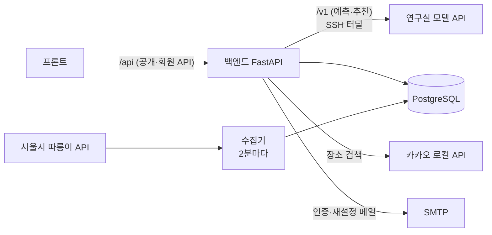
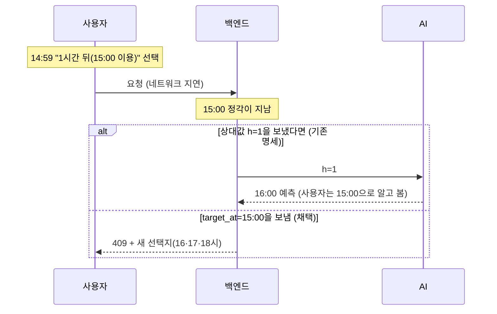
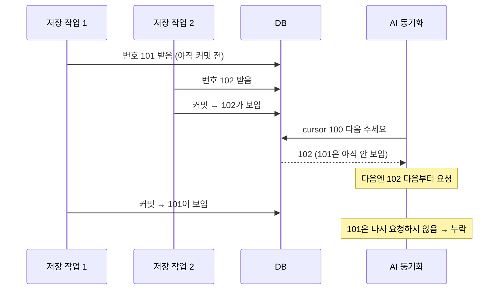
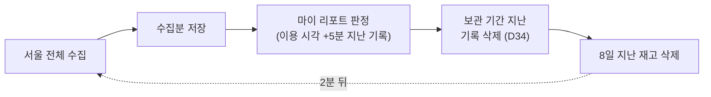
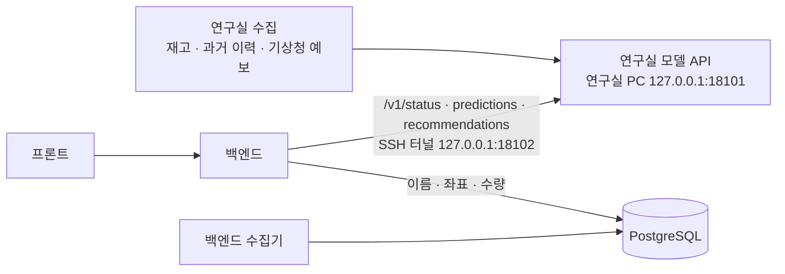

# CycleOn 백엔드 결정 기록

백엔드를 만들면서 정한 중요한 사항을 **구현한 순서(커밋 순서)대로** 적는다. 항목마다 무엇을 정했는지(사항), 왜 그렇게 정했는지(근거), 그 결과 무엇이 좋아졌는지(효과)를 남긴다.

- 기간: 2026-11-03 ~ 2026-11-27, 브랜치 `feature/backend`(~11-26), 이후 기능별 브랜치
- 코드 구조·실행 방법은 [README](../README.md), 요청·응답 필드는 「CycleOn 공개 API 명세」가 기준이다.
- 🔥 표시는 구현이 특히 어려웠거나 오래 고민한 항목이다. 문제 상황과 해결 방법을 함께 적었다.

## 한눈에 보기

| # | 날짜 | 커밋 | 단계 | 주요 결정 |
| --- | --- | --- | --- | --- |
| 1 | 11-03 | `dc38d4b` | 기본 구조 | 계층 분리(api·services·repositories·clients) |
| 2 | 11-05 | `0c836da` | 설정·오류·시각 | 🔥 이용 시각은 `target_at`으로 받기, 오류 모양 통일 |
| 3 | 11-06 | `c752d77` | AI 중계 | 기준 정각은 백엔드 시계로, AI 값의 의미는 바꾸지 않기, AI 401 → 502 |
| 4 | 11-06 | `66cabcc`, `8b6812a` | DB | asyncpg, Alembic, 🔥 대여소 revision과 `valid_from`, 0대와 누락 구분 |
| 5 | 11-06 | `ccf15a5` | 수집기 | 🔥 완전 수집분만 저장, 2분 수집·8일 보관, 인증키 오류면 멈춤 |
| 6 | 11-06 | `cedec86` | AI용 내부 API | 🔥 커서 번호를 커밋 순서대로 붙이기(advisory lock). 11-26 API 삭제(D38) |
| 7 | 11-07 | `497d8ed` | 조회 API | DB+AI 합치기, AI 장애 시 200으로 대체, 재고 신선도는 백엔드가 계산 |
| 8 | 11-07 | `cafd806` | CI | 실제 PostgreSQL로 테스트, CI에서는 건너뛰기를 실패로 |
| 9 | 11-09 | `0c6856e` | 로그인 | 서버 세션(JWT 아님), 🔥 bcrypt를 스레드풀에서, Origin 확인, 횟수 제한 |
| 10 | 11-09 | `65689a3` | 즐겨찾기 | 게스트는 브라우저에, 동의하면 옮기기, 20개 한도는 잠금 안에서 |
| 11 | 11-09 | `0b23413` | 장소 검색 | 카카오 키는 서버에만, 위치·검색어를 로그에서 지우기, gzip |
| 12 | 11-09 | `a427479` | 이메일 복구 | 🔥 재설정 요청은 항상 202(계정 존재를 숨김), 토큰 해시 저장 |
| 13 | 11-15 | `63cb8aa` | 마이 리포트 기록 | 🔥 직선거리를 저장하지 않기, 확률은 백엔드가 직접 받기 |
| 14 | 11-15 | `2fc60c8` | 마이 리포트 판정 | 🔥 이용 시각 5분 뒤 판정, 재고를 지우기 전에 판정 |
| 15 | 11-15 | `36316fa` | 대여 표시·정리 | 2주 보관(환경변수), 수집기 회차마다 정리 |
| 16 | 11-26 | `e8998d5` ~ `5b733ab` | 모델 연결 | 연구실 모델 API 조회(입력은 연구실이 공급), 수량은 DB·확률은 모델, 내부 데이터 API 삭제 |
| 18 | 11-27 | `feature/hourly-average` | 시간대별 평균 수량 | 새 테이블 없이 7일 수집분 조회, 날짜별 평균의 평균, 옮긴 대여소는 옮긴 뒤부터 |

### 전체 구조

수집(2분)과 모델 예측(정각)은 서로 독립적으로 돈다. 모델은 재고·이력·기상 예보를 직접 모으고 우리 DB를 읽지 않는다(D36). 백엔드는 프론트와 모델 사이에서 **DB의 대여소 정보·수량과 모델의 확률을 합치는 곳**이다.

---

## 1. 기본 구조 — `dc38d4b` (11-03)

### D1. 계층을 나눈다: api → services → repositories / clients

- **사항**: 라우터(`api/`)는 입력 검증과 의존성 주입만 하고, 판단은 `services/`, DB 읽기·쓰기는 `repositories/`, 외부 호출(AI·카카오·SMTP)은 `clients/`가 맡는다.
- **근거**: 같은 판단(정각 경계, AI 장애 대체)을 여러 API가 쓴다. 라우터에 넣으면 API마다 복사된다.
- **효과**: 뒤에 만든 즐겨찾기·마이 리포트가 예측 로직(`services.stations.predict`)을 그대로 재사용했다. 409 규칙, AI 장애 처리가 모든 API에서 같다.

---

## 2. 설정·오류·시각 처리 — `0c836da` (11-05)

### D2. 🔥 이용 시각은 `horizon_hours`(1·2·3)가 아니라 `target_at`(정각 시각)으로 받는다

- **사항**: 프론트는 `GET /api/status`의 `supported_targets` 중 하나를 **그대로** 보내고, 백엔드가 간격(h)으로 바꿔 AI에 보낸다. 지원 범위를 벗어난 시각은 409 `target_not_supported`와 새 선택지를 준다.
- **문제(근거)**: 기존 명세는 프론트가 "1시간 뒤"를 보내는 방식이었다. AI는 **요청이 도착한 시각**으로 기준 정각을 잡는다. 정각 직전에 고른 요청이 정각을 넘겨 도착하면, 사용자가 본 것과 다른 시각의 예측이 **오류 없이** 나간다.

- **효과**: 잘못된 시각의 예측이 조용히 나가는 일이 없다. 프론트는 409를 받으면 선택지를 갱신하고 다시 고르게 하면 된다.
- 함께 정한 것: 시각은 문자열이 아니라 값으로 비교한다(`+09:00`과 `Z` 표기를 같게). 분·초가 붙은 시각도 409다.

### D3. 오류 응답 모양을 하나로 통일한다

- **사항**: 200이 아닌 응답은 모두 `{"error": {"code", "message", ...추가 필드}}`. FastAPI 기본 검증 오류(422)도 같은 모양으로 바꾸고 `fields`에 문제 있는 인자 이름을 넣는다.
- **근거**: 프론트가 오류마다 다른 모양을 처리하지 않도록. `code`로 분기하고 `message`는 그대로 보여 줄 수 있다.
- **효과**: 오류 코드 표 하나로 프론트 처리 방법을 정리할 수 있었다(공개 API 명세의 "오류 응답" 절).

---

## 3. AI 중계 — `c752d77` (11-06)

### D4. 기준 정각과 선택지는 백엔드 시계로 계산한다

- **사항**: `GET /api/status`의 기준 정각·`supported_targets`는 백엔드가 직접 계산한다. 실제 AI를 쓸 때는 AI 응답의 기준 정각이 백엔드와 같은지 확인한다(`CYCLEON_AI_CLOCK_CHECK`).
- **근거**: AI가 죽어 있어도 화면의 시각 선택은 동작해야 한다. 두 시계가 다르면 서로 다른 정각을 기준으로 답하게 된다.
- **효과**: AI 장애 중에도 상태 API가 200을 준다. 시계가 어긋나면 엉뚱한 예측 대신 502로 드러난다.

### D5. AI 값의 의미는 바꾸지 않는다

- **사항**: 확률 `null`을 0으로 채우거나, `reason` 코드를 다른 말로 바꾸거나, 추천 순서를 바꾸지 않는다. 프론트가 쓰지 않는 필드는 빼고, 진단 값은 `?debug=true`일 때만 넣는다.
- **근거**: `null`(모름)을 0%로 바꾸면 "안전하다"는 거짓 정보가 된다. 해석은 모델 담당의 몫이다.
- **효과**: 모델이 바뀌어도 백엔드를 고칠 일이 적다. 화면은 `reason`별로 안내 문구를 고를 수 있다.

### D6. AI의 401은 프론트에 502로 내린다

- **사항**: AI가 서비스 토큰을 거부하면(401) 502 `ai_auth_failed`, 그 밖의 AI 오류는 502 `ai_error`.
- **근거**: 401을 그대로 넘기면 프론트가 "사용자 로그인이 풀렸다"고 오해해 로그아웃시킨다. 실제로는 백엔드↔AI 설정 문제다.
- **효과**: 사용자 인증(401 `not_authenticated`)과 서버 간 인증 문제가 섞이지 않는다.

---

## 4. DB — `66cabcc`, `8b6812a` (11-06)

### D7. DB 드라이버는 asyncpg, 테이블 변경은 Alembic으로

- **사항**: SQLAlchemy 2 비동기 + asyncpg. 테이블은 `models.py`를 고친 뒤 Alembic 자동 생성으로 마이그레이션을 만든다. CI가 `alembic check`로 모델과 마이그레이션이 어긋나지 않았는지 확인한다.
- **근거**: psycopg의 비동기 모드는 Windows 기본 이벤트 루프에서 동작하지 않아, 팀원 PC(Windows)에서 실행되지 않았다.
- **효과**: Windows·Linux(CI) 모두에서 같은 코드가 돈다. 마이그레이션을 빼먹으면 CI가 막는다.
- 겪은 문제: `alembic.ini`에 한글 주석이 있으면 Windows가 cp949로 읽어 Alembic이 실행되지 않는다 → 이 파일은 영어로만 쓴다.

### D8. 🔥 대여소 정보가 바뀌면 revision을 쌓되, `valid_from`은 100m 넘게 옮겨질 때만 새로 연다

- **사항**: 대여소의 이름·좌표·상태가 바뀌면 새 revision을 저장한다. 하지만 "이 위치의 이력이 시작된 시각"(`valid_from`)은 **좌표가 100m 넘게 옮겨졌을 때만** 새로 정하고, 이름 오타 수정·좌표 미세 보정에는 원래 값을 유지한다.
- **문제(근거)**: AI는 `valid_from` 이전 재고를 버린다. 참조 구현처럼 무엇이든 바뀔 때마다 `valid_from`을 새로 잡으면, **이름 오타 하나 고친 대여소가 7일 동안 예측 불가**(`history_not_ready`)가 된다.

| 바뀐 것 | 새 revision | `valid_from` | 이유 |
| --- | --- | --- | --- |
| 이름(오타 수정 등) | 예 | 유지 | 같은 장소다. 이력을 끊을 이유가 없다 |
| 좌표 100m 이하 이동 | 예 | 유지 | 측정 보정 수준 |
| 좌표 100m 초과 이동 | 예 | 새로(지금) | 다른 장소다. 예전 재고 패턴이 맞지 않는다 |

- **효과**: 서울시가 이름만 고쳐도 예측이 끊기지 않는다.
- 함께 정한 것: 서울시 API는 일부 이름 끝에 공백을 붙여 보낸다("946. 독바위역 ") → 앞뒤 공백을 지운다. 지우지 않으면 공백 차이만으로 가짜 revision이 생긴다.

### D9. 실제 0대와 값 누락을 구분한다

- **사항**: 실제 0대는 `value=0, quality=valid`, 값이 숫자가 아니거나 음수면 `value=null, quality=invalid`.
- **근거**: 누락을 0으로 채우면 "0대 위험" 예측과 판정이 모두 왜곡된다.
- **효과**: 마이 리포트 판정도 이 구분을 그대로 써서, 값이 이상한 경우는 "판정 불가"로 둔다(D31).

---

## 5. 재고 수집기 — `ccf15a5` (11-06)

### D10. 🔥 서울 전체를 끝 페이지까지 받은 경우에만, 한 트랜잭션으로 저장한다

- **사항**: 서울시 API는 한 번에 1,000곳씩 준다(약 2,700곳, 3페이지). 수집 1회(capture)는 모든 페이지를 받은 뒤에만 capture·대여소 revision·재고를 **한 트랜잭션으로** 저장한다. 중간에 실패하면 그 회차 전체를 버린다.
- **문제(근거)**: 페이지마다 저장하면, AI가 동기화하는 순간 "서울의 절반만 있는 수집분"을 볼 수 있다. AI는 그 수집분을 정각 기준 재고로 써서 나머지 대여소를 "재고 없음"으로 처리한다.
- **효과**: AI와 마이 리포트 판정이 보는 수집분은 항상 서울 전체다.
- 함께 정한 것:
  - 끝 판단: 1,000건 미만 페이지가 오거나 `INFO-200`(데이터 없음)이 오면 끝. 응답의 `list_total_count`는 서울 전체가 아니라 그 페이지 개수라서 쓸 수 없었다.
  - 한 대여소의 값이 이상하다고 서울 전체 회차를 버리지 않는다 → 그 행만 `null`(D9).
  - 요청 사이 1.1초 간격(서울시 API에 부담을 주지 않게).

### D11. 2분마다 수집하고 8일(192시간) 보관한다

- **사항**: 수집 간격 120초, 192시간 지난 재고는 수집기가 지운다.
- **근거**:
  - 추천은 300초(5분) 안의 최신 재고가 있어야 동작한다 → 5분보다 촘촘해야 한다.
  - 참조 구현의 60초 간격은 약 2,700곳 × 하루 1,440회 = **하루 약 390만 행**이다. AI가 실제로 쓰는 것은 정각 직전 5분 안 1회와 최신 1회뿐이라 2분으로 충분하다(절반으로 줄어듦).
  - AI 첫 동기화가 최근 170시간을 요청하므로 보관은 그보다 길어야 한다.
- **효과**: DB 크기와 AI 동기화량을 절반으로 줄이면서 추천·예측 조건을 모두 만족한다.
- **변경(11-26, D38)**: 내부 데이터 API를 지우며 170시간 근거가 사라졌다. 하한은 24시간(마이 리포트 판정에 필요한 수집분보다 길게)으로 낮추고 기본 8일은 유지한다.

### D12. 인증키 오류·한도 초과면 재시도하지 않고 멈춘다. 인증키는 로그에 남기지 않는다

- **사항**: `INFO-100`(인증키 오류), `ERROR-3xx`(요청 오류·한도 초과)면 수집기를 종료한다. 서버 오류(`ERROR-5xx`)·네트워크 오류는 그 회차만 버리고 계속한다. 로그에는 오류 종류만 남긴다.
- **근거**: 키 문제는 다시 시도해도 같고, 한도를 계속 두드리면 상황이 나빠진다. 서울시 API는 인증키를 **URL 경로**에 넣어서, URL이나 예외 메시지를 로그에 남기면 키가 새어 나간다(httpx의 INFO 로그도 URL을 찍어서 WARNING 이상만 남긴다).
- **효과**: 사람이 확인해야 할 문제는 바로 드러나고, 일시적 문제에는 수집기가 죽지 않는다.

---

## 6. AI용 내부 데이터 API — `cedec86` (11-06)

### D13. 🔥 커서 번호는 DB 시퀀스가 아니라 잠금 안에서 `max+1`로 붙인다

- **사항**: AI는 20초마다 "마지막으로 받은 번호(cursor) 다음"부터 새 기록을 가져간다. 이 번호(`cursor_seq`)를 테이블별 트랜잭션 잠금(`pg_advisory_xact_lock`) 안에서 `max(cursor_seq)+1`로 붙인다. 기본 키와는 따로 둔다.
- **문제(근거)**: DB 시퀀스는 **번호를 받은 순서와 커밋 순서가 다를 수 있다.** 그러면 AI가 작은 번호를 영영 놓친다.

- **해결**: 잠금은 커밋할 때 풀리므로 저장 작업이 한 줄로 서고, **번호 순서 = 커밋 순서**가 된다. 그래서 "지금 보이는 가장 큰 번호 이하는 모두 커밋됐다"가 보장되어, 그 값을 `watermark`로 돌려줄 수 있다. 잠금은 항상 stations → observations 순서로 잡아 교착을 막는다.
- **효과**: AI가 받는 기록에 빈 번호가 생기지 않는다. 동기화 중에 새로 커밋된 기록은 이번이 아니라 다음 회차(20초 뒤)에 받는다.
- **변경(11-26, D38)**: 내부 데이터 API는 지웠다. `cursor_seq`와 잠금은 대여소의 최신 revision을 고르는 데 계속 쓴다.

---

## 7. 조회 API — `497d8ed` (11-07)

### D14. 대여소 이름·좌표는 DB에서, 확률은 AI에서 받아 백엔드가 합친다

- **사항**: AI 예측 응답에는 이름·좌표가 없다. 백엔드가 자기 DB의 대여소 정보와 합쳐 내려준다. 반경 검색·거리 계산도 백엔드가 한다. AI에는 한 번에 500곳씩 나눠 묻는다(AI 한도).
- **근거**: 프론트가 두 곳을 따로 부르고 합치지 않게. 대여소 정보의 기준(D8)이 백엔드 DB에 있다.
- **효과**: 프론트가 부를 공개 API가 5개로 줄었다.

### D15. AI가 죽어도 지도와 목록은 동작한다 (200 + `ai_available: false`)

- **사항**: AI 접속 실패·시간 초과면 오류 대신 200을 주고, 확률은 `null`, `reason: "ai_unavailable"`, 수량은 백엔드 DB의 최신 수집분으로 채운다. 단, 추천은 대체할 수 없어 503이다. AI의 401·5xx(설정·버그)는 대체하지 않고 502로 드러낸다.
- **근거**: 지도·수량은 AI 없이도 의미가 있다. 반대로 설정 오류까지 숨기면 아무도 고치지 않는다.
- **효과**: AI 서비스가 재시작되는 동안에도 사용자는 지도와 현재 수량을 본다.
- **변경(11-26, D37)**: 수량은 AI가 켜져 있어도 항상 DB 최신 수집분이다. 아래 표의 "수량은 DB"는 이제 평소에도 같다.

| API | AI가 죽었을 때 |
| --- | --- |
| 상태·주변·선택 예측·즐겨찾기 목록 | 200, 확률 `null`, 수량은 DB |
| 대여소 목록, 장소 검색, 로그인·회원 | 영향 없음 |
| 추천 | 503 `ai_unavailable` |
| 마이 리포트 기록 | 200 `recorded: false` (기록하지 않음) |

### D16. 최신 재고가 오래됐는지는 백엔드가 판단해서 내린다 (`inventory_fresh`)

- **사항**: 기존 명세는 프론트가 `age_seconds ≥ 300`을 보고 경고하는 방식이었다. 백엔드가 계산한 `inventory_fresh`(true/false)를 내린다.
- **근거**: AI는 나이 상한 없이 마지막 수집분을 준다. 수집기가 멈추면 며칠 전 재고가 "현재 수량"으로 보일 수 있다. 기준(300초)이 프론트 여러 곳에 흩어지면 바뀔 때 놓친다.
- **효과**: 기준이 한 곳에 있고, 프론트는 true/false만 본다.

---

## 8. CI — `cafd806` (11-07)

### D17. 실제 PostgreSQL로 테스트하고, CI에서는 DB 테스트를 건너뛰면 실패로 친다

- **사항**: GitHub Actions에서 PostgreSQL을 띄워 `alembic check`와 전체 테스트를 돌린다. 로컬에서는 DB가 꺼져 있으면 DB 테스트를 건너뛰지만, CI에서는 건너뛰기를 실패로 처리한다. 서울시 API·AI·카카오·SMTP는 가짜(httpx MockTransport 등)를 써서 비밀값 없이 돈다.
- **근거**: 잠금(D13), 트랜잭션(D10), 제약 조건은 SQLite나 가짜 DB로는 검증되지 않는다. "DB가 없어서 조용히 건너뛰었는데 통과"가 가장 위험하다.
- **효과**: 테스트 247개(11-15 기준)가 실제 DB에서 돈다. 비밀값이 저장소에 없어도 누구나 테스트를 돌릴 수 있다.

---

## 9. 로그인·회원 — `0c6856e` (11-09)

### D18. 아이디·비밀번호 + 서버 세션(HttpOnly 쿠키). JWT는 쓰지 않는다

- **사항**: 로그인하면 무작위 토큰을 `cycleon_session` 쿠키(HttpOnly, SameSite=Lax)로 주고, DB에는 토큰의 **SHA-256 해시만** 둔다. 마지막 사용 후 14일, 로그인 후 30일 중 먼저 오는 때 끝난다. 이메일 로그인 대신 아이디 로그인으로 정했다(11-09).
- **근거**: JWT는 서버가 발급 후 취소하기 어렵다(로그아웃·비밀번호 변경이 바로 반영되지 않음). 서버 세션은 DB 행을 지우면 즉시 끝난다. 해시만 저장하면 DB가 유출돼도 세션을 가로챌 수 없다. HttpOnly라 스크립트가 쿠키를 읽을 수 없다.
- **효과**: 로그아웃, "모든 기기 로그아웃", 비밀번호 변경 시 다른 기기 로그아웃이 바로 적용된다.

### D19. 🔥 bcrypt 계산은 스레드풀에서 돌린다

- **사항**: 비밀번호는 bcrypt(비용 12) 해시로만 저장하고, 계산은 이벤트 루프 밖 스레드풀에서 한다. 규칙은 NIST SP 800-63B를 따라 특수문자 필수 같은 조합 규칙 대신 길이와 흔한 비밀번호 차단을 쓴다.
- **문제(근거)**: bcrypt는 무차별 대입을 막으려고 **일부러 느리다**(1회 약 0.2~0.3초). FastAPI 비동기 서버에서 그대로 돌리면 로그인 한 번 동안 **다른 모든 API가 멈춘다.**
- **효과**: 로그인이 몰려도 지도·예측 API가 멈추지 않는다. 테스트에서만 비용을 4로 낮춰 빠르게 돈다. 같은 이유로 SMTP 메일 발송도 스레드풀에서 돌린다.

### D20. 회원 정보를 바꾸는 요청은 Origin을 확인한다 (CSRF 방지)

- **사항**: 로그인·가입·회원 변경 요청에 `Origin` 헤더가 있으면 허용 목록(`CORS_ORIGINS`)에 있어야 한다(아니면 403). 본문은 JSON만 받는다(폼 전송은 415).
- **근거**: 쿠키 세션은 다른 사이트가 몰래 보낸 요청에도 쿠키가 실린다(CSRF). 브라우저는 다른 사이트에서 보낸 요청에 항상 Origin을 붙이고, HTML 폼으로는 JSON을 보낼 수 없다. Origin이 없는 요청은 브라우저가 아닌 도구(curl 등)라 허용한다.
- **효과**: CSRF 토큰을 따로 주고받지 않고도 막을 수 있다.

### D21. 로그인 실패·가입 횟수를 제한한다

- **사항**: 같은 아이디+IP 로그인 실패 15분 5회, 같은 IP 실패 15분 30회, 같은 IP 가입 1시간 10회. 넘으면 429와 남은 시간. 아이디가 없든 비밀번호가 틀리든 같은 응답(401 `invalid_credentials`)을 준다.
- **근거**: 비밀번호 무차별 대입, 가입된 아이디 알아내기를 막는다. 리버스 프록시 뒤에서는 믿는 프록시가 보낸 `X-Forwarded-For`만 실제 IP로 쓴다(아무 헤더나 믿으면 제한을 피할 수 있다).
- **효과**: 대입 공격이 15분에 5번으로 묶인다.

---

## 10. 즐겨찾기 — `65689a3` (11-09)

### D22. 게스트 즐겨찾기는 브라우저에 두고, 가입·로그인할 때 동의하면 계정으로 옮긴다

- **사항**: 게스트는 서버에 아무것도 저장하지 않는다(브라우저에 두고 `POST /api/predictions`로 예측을 받음). 로그인 후 사용자가 동의하면 `POST /api/me/favorites/import`로 옮긴다(최대 100개, 20개 한도까지 앞에서부터).
- **근거**: 게스트 정보를 서버에 두면 개인정보 관리 대상이 늘어난다. 묻지 않고 옮기면 공용 PC에서 남의 즐겨찾기가 섞인다.
- **효과**: 로그인 없이 모든 조회 기능을 쓸 수 있고, 가입해도 즐겨찾기를 잃지 않는다.

### D23. 20개 한도는 회원 행을 잠근 상태에서 센다

- **사항**: 추가할 때 그 회원의 행을 잠그고 개수를 센 뒤 넣는다. 이미 있는 대여소는 바꾸지 않고 200, 운영 중이 아닌 대여소는 404.
- **근거**: 잠그지 않으면 두 탭에서 동시에 추가할 때 둘 다 "19개"를 보고 21개가 된다.
- **효과**: 동시 요청에서도 한도가 지켜진다.

---

## 11. 장소 검색·대여소 목록 — `0b23413` (11-09)

### D24. 카카오 REST 키는 서버에만 두고, 위치·검색어는 로그에 남기지 않는다

- **사항**: 장소 검색은 백엔드가 카카오 로컬 API를 중계한다(키워드 검색 → 없으면 주소 검색, 서울 안 최대 5개). uvicorn 접속 로그는 쿼리를 지우고 경로만 남긴다(`app/core/log_filters.py`).
- **근거**: 브라우저가 직접 부르면 REST 키가 노출된다. 검색어("우리 집 주소")와 `lat`·`lon`은 사용자 위치다. uvicorn은 기본으로 쿼리까지 로그에 남긴다.
- **효과**: "사용자 위치는 저장·로깅하지 않는다"는 공통 규칙을 로그까지 지킨다.

### D25. 대여소 목록에 지금 수량을 붙이고, 캐시 없이 gzip으로 준다

- **사항**: `GET /api/stations`에 DB 최신 수집분의 수량을 붙여 마커 색에 쓰게 했다. 캐시 헤더 없이 매번 주고, 1,000바이트 넘는 응답은 gzip으로 압축한다.
- **근거**: 지도 첫 화면에서 대여소 2,700곳의 수량을 한 번에 보여 줘야 한다. 수량은 2분마다 바뀌어 캐시하면 오래된 값이 보인다. 대신 응답이 커서 압축한다.
- **효과**: 마커 색을 위해 대여소마다 예측을 따로 부를 필요가 없다.

---

## 12. 이메일 인증·비밀번호 재설정 — `a427479` (11-09)

### D26. 🔥 재설정 요청은 계정이 있든 없든 항상 같은 202를 주고, 메일은 응답 뒤에 보낸다

- **사항**: `POST /api/auth/password-reset`은 결과와 관계없이 202를 준다. 메일 발송은 응답을 보낸 뒤 처리한다.
- **문제(근거)**: "가입되지 않은 아이디입니다"라고 답하면 가입 여부가 드러난다. 같은 202를 주더라도 메일을 보내는 경우만 SMTP 때문에 1~2초 늦게 답하면, **응답 시간으로 계정 존재를 알아낼 수 있다.**
- **효과**: 응답 내용과 응답 시간 모두에서 계정 존재 여부가 드러나지 않는다.

### D27. 링크 토큰은 해시로 저장하고, 30분·1회·상태가 바뀌면 무효

- **사항**: 토큰은 무작위 256비트, DB에는 SHA-256 해시만 둔다. 30분 유효, 한 번만 쓴다. 토큰을 만든 뒤 이메일이나 비밀번호가 바뀌었으면 그 토큰은 무효다. 한 회원에게 15분에 3통까지만 보낸다. 이메일은 선택이고 로그인에는 쓰지 않는다.
- **근거**: DB가 유출돼도 링크를 만들 수 없게. 예전 메일함에 남은 링크로 바뀐 계정을 되돌리지 못하게. 메일 폭탄을 막기 위해.
- **효과**: 메일 링크 하나가 새도 피해 범위가 30분·1회로 제한된다. SMTP 설정만 바꾸면 Gmail·Resend·SES·Mailpit(개발) 어느 것이든 쓸 수 있다.

---

## 13. 마이 리포트 — 예측 확인 기록 — `63cb8aa` (11-15)

### D28. 🔥 사용자 위치와 대여소까지의 직선거리는 저장하지 않는다 (시안의 "직선거리" 칸 제거)

- **사항**: UI 시안의 리포트 카드에는 "직선거리 350m"가 있었다. 이를 위해 "기록할 때만 위치를 받아 **거리 숫자만** 저장하는 안"(B안)을 검토했지만, 거리를 저장하지 않는 A안으로 정했다(11-14).
- **문제(근거)**:
  - 대여소 좌표는 공개다. "대여소 A에서 350m"는 A를 중심으로 한 원 위에 있었다는 뜻이다. 같은 곳(집·직장)에서 서로 다른 대여소 3곳을 본 기록이 쌓이면 **세 원이 겹치는 점이 그 위치**다(삼변측량). 50m 단위로 반올림해도 건물 몇 채 범위까지 좁혀진다.
  - "300m 이내"처럼 구간으로 흐려도 생활권(동네)은 드러난다.
  - 위치를 거의 되살릴 수 있는 기록을 계정에 붙여 보관하면 개인위치정보로 볼 여지가 커진다.
  - 얻는 것은 카드 한 줄이다.
- **효과**: 백엔드 공통 규칙("사용자 위치는 저장·로깅하지 않는다")과 README의 개인정보 원칙을 그대로 지킨다. `prediction_views` 테이블에는 위치·거리 칸이 아예 없다.

### D29. 확률은 프론트가 보내지 않고, 백엔드가 AI에서 직접 받아 저장한다

- **사항**: `POST /api/me/views`는 대여소와 이용 시각만 받는다. 백엔드가 기존 예측 로직으로 확률을 받아 저장한다. 확률이 `null`이면(AI 꺼짐, 대상 아님) 저장하지 않고 `recorded: false`와 이유를 돌려준다.
- **근거**: 프론트가 보낸 확률을 믿으면 조작된 값이 리포트와 적중률에 섞인다. "예측 없음"을 기록하면 적중률 계산이 의미를 잃는다.
- **효과**: 리포트의 모든 카드는 실제로 그때 AI가 낸 예측이다.

### D30. 대여소 상세와 추천에서 고른 대여소만 기록하고, 같은 대여소·이용 시각은 한 번만 남긴다

- **사항**: 기록은 대여소 상세 화면과 추천 결과에서 고른 대여소 두 곳에서만 한다(지도 마커 카드, 주변·즐겨찾기 목록은 제외). (회원, 대여소, 이용 시각)이 유일하고 처음 본 예측을 유지한다. 이미 있으면 AI를 부르지 않는다. 동시 요청은 `ON CONFLICT DO NOTHING`으로 처리한다.
- **근거**: 목록을 열 때마다 기록하면 한 번에 수십 건이 쌓여 "확인한 예측"이 의미를 잃는다. 다시 볼 때마다 새 예측으로 바꾸면 "처음 판단한 예측이 맞았나"를 볼 수 없다.
- **효과**: 프론트는 화면을 열 때마다 불러도 된다(중복 걱정 없음).

---

## 14. 마이 리포트 — 판정과 주간 리포트 — `2fc60c8` (11-15)

### D31. 이용 시각 직전 5분 안에 완료된 수집분의 실제 수량과 비교한다

- **사항**: 위험 예측 + 실제 0대, 위험 아님 + 1대 이상이면 **맞음(hit)**, 반대면 **틀림(miss)**. 그 5분 안에 수집분이 없거나 값이 비정상이면 **판정 불가(unknown)**. 적중률은 맞음 ÷ (맞음+틀림)이고 판정 불가는 분모에서 뺀다.
- **근거**: 모델이 정각의 기준 재고를 잡는 방식과 같아야 공정하다. 수집기가 멈춘 시간을 "틀림"으로 치면 모델 탓이 아닌 것이 적중률을 깎는다.
- **효과**: 결과가 네 가지(맞음·틀림·판정 불가·판정 전)로 명확하게 나뉜다.

### D32. 🔥 판정은 이용 시각 5분 뒤부터, 그리고 재고를 지우기 전에 한다

- **사항**: 판정은 이용 시각 + 5분이 지나야 시작한다. 리포트를 열 때(그 회원의 기록) 그리고 **수집기가 회차마다 오래된 재고를 지우기 전에**(모든 회원) 판정한다. 한 번 정한 결과는 저장해 두고 바꾸지 않는다.
- **문제(근거)**:
  1. 정각에 바로 판정하면, 정각 직전에 시작한 수집 회차가 **아직 저장 중**일 수 있다(서울 전체 3페이지에 수 초). 그 순간 판정하면 수집분이 없다고 보고 "판정 불가"로 굳어 버린다.
  2. 재고는 8일만 보관한다(D11). 리포트를 열 때만 판정하면, 8일 넘게 리포트를 열지 않은 회원의 기록은 비교할 재고가 이미 지워져 모두 "판정 불가"가 된다.

```mermaid
gantt
    dateFormat HH:mm
    axisFormat %H:%M
    title 이용 시각 18시 기록의 판정
    section 수집기
    비교에 쓰는 수집분 범위 (17시 55분~18시 완료) :active, 17:55, 5m
    정각 직전 회차가 아직 저장 중일 수 있음 :crit, 18:00, 2m
    section 판정
    판정 전 (outcome null) :18:00, 5m
    판정 가능 (첫 수집기 회차 또는 리포트 열기) :milestone, 18:05, 0m
```

- **효과**: 판정 결과가 수집 타이밍 때문에 틀어지지 않고, 리포트를 오래 열지 않아도 결과가 남는다. 판정·정리 중 하나가 실패해도 수집은 계속된다.

### D33. 리포트는 월~일 한 주 단위(KST, 이용 시각 기준), 고를 수 있는 주는 응답이 알려 준다

- **사항**: `GET /api/me/report?week=<월요일>`. 응답의 `weeks`(이번 주부터 최신 순)에 없는 주, 월요일이 아닌 날짜, 미래 주는 422. 요약은 `viewed`·`judged`·`hits`·`rented`이고 비율은 프론트가 계산한다.
- **근거**: 시안의 기간 선택(05.11~05.17)이 주 단위다. 고를 수 있는 주를 서버가 알려 주면 보관 기간(D34)이 바뀌어도 프론트를 고칠 필요가 없다. 주 경계는 UTC가 아니라 한국 시간 월요일 0시여야 일요일 밤 기록이 다음 주로 넘어가지 않는다.
- **효과**: 테스트로 주 경계(일요일 23시 → 월요일 0시 KST)를 확인했다.

---

## 15. 마이 리포트 — 대여 표시·지우기·보관 기간 — `36316fa` (11-15)

### D34. 기록은 2주(이번 주와 지난주)만 두고, 수집기가 회차마다 정리한다

- **사항**: 이용 시각 기준 이번 주 포함 `CYCLEON_VIEW_RETENTION_WEEKS`주(기본 2, 1~12)만 남긴다. 처음에는 4주로 정했다가 2주로 줄이고 환경변수로 뺐다(11-15). 오래된 기록은 별도 예약 작업 없이 **수집기가 회차마다** 지운다.
- **근거**:
  - 기록이 길게 쌓일수록 "언제 어느 대여소를 보는지"라는 이동 패턴이 드러나는 개인정보가 된다.
  - 4주는 서버에 올려 직접 확인하기에 너무 길었다. 환경변수로 두면 테스트 서버에서 1주로 바로 확인할 수 있다.
  - 지우는 기준은 월요일 0시에만 바뀐다. 회차마다 지워도 결과는 매일 지우는 것과 같고, 주가 바뀌면 바로 반영된다. 이미 2분마다 도는 프로세스가 있어 cron 같은 별도 예약이 필요 없다.
- **효과**: 운영 구성 요소를 늘리지 않고 보관 기간을 지킨다.

### D35. "대여함"은 이용 시각이 지난 뒤에만, 남의 기록은 있는지조차 알려 주지 않는다

- **사항**:
  - `PATCH /api/me/views/{id}` `{"rented": true|false|null}`. 이용 시각 전 표시는 409 `target_not_passed`, 표시 지우기(`null`)는 언제든. `rented`를 빼면 422(실수로 지워지지 않게).
  - 없거나 다른 회원의 기록이면 둘을 구분하지 않고 404 `view_not_found`.
  - 지우기(`DELETE /api/me/views/{id}`, `DELETE /api/me/views`)는 없는 기록이어도 204(즐겨찾기 삭제와 같음).
- **근거**: 대여 성공 여부는 따릉이 계정과 연동할 수 없어 사용자가 직접 표시한 값만 있다. 아직 오지 않은 이용 시각에 "대여했다"는 말이 안 된다. 403과 404를 나누면 남의 기록 ID가 있는지 알아낼 수 있다.
- **효과**: 시안에 없던 "기록 전체 지우기"로 사용자가 자기 기록을 직접 지울 수 있다(기록 끄기 설정 대신).

---

## 16. 모델 연결 — 연구실 모델 API 조회 — `e8998d5` ~ `5b733ab` (11-26)

모델팀이 11-26에 최종 기상 모델(1시간 P53, 2시간 P51, 3시간 P48)을 공개했다(main `dcca686`). 모델팀 연동 가이드는 팀 백엔드가 연구실 모델 API를 SSH 터널로 조회하는 경로를 안내한다.

### D36. 팀 백엔드는 연구실 모델 API를 조회만 한다. 모델 입력은 연구실이 공급한다

- **사항**: `CYCLEON_AI_BASE_URL`의 기본값은 SSH 터널(`ssh -N -L 18102:127.0.0.1:18101 amsl-lab`)로 연 `http://127.0.0.1:18102`다. 토큰은 운영 담당자가 비공개로 전달한 연구실 서버 토큰을 서버 환경변수에만 둔다. 백엔드는 모델에 아무 입력도 보내지 않는다.
- **근거**:
  - 연구실 API는 재고·과거 이력·기상청 예보를 직접 모아 최종 모델을 돌린다. 모델팀 가이드가 입력을 중복 전송하지 말고 중복 서버·수집기도 띄우지 말라고 안내한다.
  - 자체 모델 서버를 두려면 기준 정각 재고 snapshot과 최종 모델 입력(`final_inputs`: 정각 재고 이력 최대 671시간 + 기상청 초단기예보 격자)을 모델에 보내야 한다. 기상청 수집기, 7일 이상 쌓인 이력, 회당 약 7~8MB 전송이 필요하다. 같은 일을 연구실이 이미 하고 있다.
  - 로컬 포트 18102는 모델팀 빠른 시작 문서와 같다. 자기 PC에서 모델 서버(18101)를 띄워도 겹치지 않는다.
- **효과**: 백엔드는 화면 API, AI 중계, 서울시 재고 수집만 맡는다. 연구실이 응답하지 않으면 D15대로 지도·목록은 동작하고 추천만 503이다. `/api/status?debug=true`의 `model_route`·`primary_prediction_count`로 최종 기상 모델이 도는지 확인한다.
- **주의**: 연구실 API는 인터넷 공용 주소가 없다. 배포 서버에서 터널을 계속 유지해야 한다(README 남은 일).

### D37. 공개 API의 수량은 항상 DB, 확률만 모델에서 받는다

- **사항**: nearby·predictions·즐겨찾기의 수량(`latest_inventory`·`received_at`·`inventory_fresh`)은 AI 켜짐·꺼짐과 관계없이 DB 최신 수집분이다. `available_probability`(목표 정각에 1대 이상 있을 확률)를 nearby·predictions·recommendations·즐겨찾기 항목에 추가했다. 추천 결과만 모델 값(추천 판단에 쓴 값)이다.
- **근거**: 연구실은 재고를 따로 수집하므로 수신 시각이 우리 DB와 조금씩 다르다. DB 값을 쓰면 지도(`/api/stations`)와 출처가 같고, 모델이 모르는 대여소도 수량을 보여 준다. 모델팀 프론트 안내가 "1대 이상 있을 확률"을 주 문구로 쓰라고 한다.
- **효과**: 같은 대여소의 수량이 화면마다 다르게 보이지 않는다. 필드 추가라 기존 프론트 코드는 깨지지 않는다.

### D38. 모델이 쓰지 않는 내부 데이터 API(pull)를 지운다

- **사항**: `/internal/ai-data/v1/stations`·`observations`·`forecasts` 라우터·스키마·커서 조회와 서비스 토큰 검사를 지웠다(이제 404). 재고 보관 하한은 170시간 → 24시간(기본 8일 유지). `cursor_seq` 컬럼과 잠금은 revision 순서용으로 남겼다.
- **근거**: 이 API를 쓰던 예전 AI 서비스(20초마다 동기화)는 연구실 모델 API로 바뀌었고, 연구실은 우리 DB를 읽지 않는다. 쓰지 않는 인증 경로는 공격 지점만 늘린다.
- **효과**: 서비스 토큰은 이제 백엔드가 모델을 부를 때만 쓴다.

---

## 18. 시간대별 평균 수량 — `feature/hourly-average` (11-27)

### D40. 대여소 상세의 시간대별 평균은 새 테이블 없이 최근 7일 수집분에서 바로 계산한다

- **사항**: `GET /api/stations/{station_id}/hourly-average?day_type=weekday|weekend|all` → KST 0~23시마다 `avg_inventory`(소수 첫째 자리, 값이 없으면 `null`)·`samples`, 실제로 들어간 날 수 `days`, 계산 기간 `period_start`·`period_end`. 기간은 오늘 포함 KST 달력 7일(시작은 6일 전 0시)이고, `day_type`을 빼면 오늘의 유형이다. 운영 중이 아닌 대여소는 404 `station_not_found`. `Cache-Control: max-age=600`.
- **계산 규칙**:
  - 완료된 수집분의 `quality='valid'` 재고만 쓴다. 비정상·누락은 0으로 세지 않고 뺀다(4장 "0대와 누락 구분").
  - SQL은 KST 날짜·시간별 평균(최대 7×24행)만 내고, 평일·주말 거르기와 "평균의 평균"은 Python이 한다. 수집기가 멈춘 날이 있어도 날마다 같은 무게가 된다.
  - 대여소가 100m 넘게 옮겨졌으면 현재 revision의 `valid_from` 이후만 쓴다. 이름·미세 좌표 변경은 `valid_from`이 그대로라 이력이 이어진다. 새 대여소도 같은 규칙이라 `period_start`가 처음 받은 시각이 된다.
  - 공휴일은 구분하지 않는다(요일만 본다).
- **근거**: 수집기가 이미 8일을 보관하고 있어 새 테이블·배치 없이 만들 수 있다. 한 대여소의 7일치는 약 5,040행이라 요청마다 계산해도 된다(아래 측정).
- **성능**: 8일 보관 규모의 합성 데이터(2,740곳 × 5,760회 = 1,578만 행, DB 5.9GB)로 `EXPLAIN ANALYZE`를 돌렸다. 기존 유일 인덱스 `(source, entity_id, event_key, variable, revision)`의 앞 두 열로 대여소 한 곳의 5,760행만 읽고, 디스크에서 처음 읽을 때 31~50ms, 캐시된 뒤 약 10ms다. 그래서 `(entity_id, received_at)` 인덱스는 추가하지 않았다. 10분 캐시 헤더로 같은 브라우저의 반복 조회도 줄인다.
- **한계**: 주말 평균은 이틀치다. 더 긴 기간이 필요하면 수집기가 시간 단위 요약 테이블을 채우고 여러 주 보관하도록 바꾸고, API 모양은 그대로 둔다.

---

## 만들지 않기로 한 것

| 항목 | 이유 |
| --- | --- |
| 모델 입력 공급(snapshot 전송, 최종 모델 입력 `final_inputs`, 기상청 예보 수집) | 연구실 모델 API가 재고·이력·예보를 직접 모은다(D36). 자체 모델 서버가 필요해지면 모델팀 `BACKEND_MODEL_INTEGRATION.md` 기준으로 새로 설계한다 |
| 실제 탑승 기록(이용 시간·거리) | 따릉이 계정과 연동할 수 없고, 웹에서 위치를 계속 추적하면 기록이 끊기고 사용자 위치를 저장하게 된다 |
| 소셜 로그인, 알림, 반납 대여소 만차 위험 | 1차 범위 밖. 만차는 모델이 예측하지 않는다 |
| 충돌(conflict) 재발행 | 수집 회차마다 새 `capture_id`를 써서 충돌이 생기지 않는다. 다른 출처를 넣을 때 추가 |
| 마이 리포트 기록 끄기 설정 | 2주 보관 + 기록 전체 지우기로 대신 |
