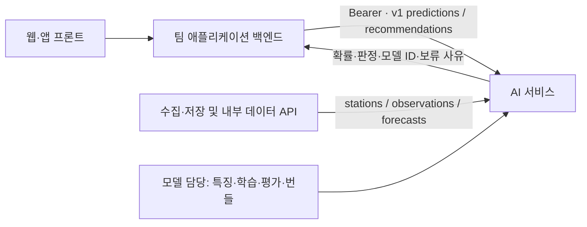

# CycleOn 모델 API 연동 가이드

> **Draft v0.1 · 2026-10-29 · API v1**
> 대상: 백엔드·프론트엔드·QA 담당자. 구현 기준: `cycleon/api.py`, `contracts.py`, `engine.py`.

CycleOn은 사용자가 따릉이 대여소로 이동하는 사이 재고가 달라지는 문제를 다룬다. 이용 예정 정각의 **0대 위험 확률**, 최신 재고, 주변 대여소까지의 직선거리를 비교해 대여소 선택을 돕는다. 출퇴근·우천 상황에서도 같은 목표 시각의 후보를 비교하는 것이 제안서의 방향이다.

이 초안은 다른 팀이 모델 학습 완료를 기다리지 않고 데이터 연결과 화면 개발을 시작하기 위한 계약이다. 모델 담당자가 특징 생성·학습·보정·평가와 AI 서비스를 관리하고, 서비스 팀이 저장소·애플리케이션 백엔드·화면을 구현한다.

## 바로 시작하기

| 목적 | 문서·파일 |
| --- | --- |
| 모델·실서버 없이 API를 호출해 보기 | [빠른 시작](QUICKSTART.md) |
| HTTP 경로·필드·제약·오류 확인 | [API 레퍼런스](API_REFERENCE.md) |
| 수집 데이터와 AI 연결 구현 | [백엔드 인수 명세](BACKEND_HANDOFF.md) |
| 화면 상태·사용자 흐름 구현 | [프론트엔드 인수 명세](FRONTEND_HANDOFF.md) |
| 모델 범위·진행률·제약 확인 | [모델 상태와 입출력](MODEL_STATUS.md) |
| Swagger/Postman 또는 코드 생성 도구에 입력 | [AI OpenAPI](../cycleon_ai_openapi.json), [데이터 OpenAPI](../cycleon_backend_openapi.json) |
| 호출 모음·테스트 데이터 | [Postman collection](CycleOn.postman_collection.json), [합성 예시 JSON](mock_examples.json) |

## 연결 구조와 책임

| 담당 | 제공·구현 범위 | 연결 완료 확인 |
| --- | --- | --- |
| 모델 | 공통 특징, 모델·보정기·임계값, 번들 검증, AI API, 최종 모델·정책 평가 | 같은 API 계약으로 개발 모델/선정 모델을 교체 |
| 백엔드 | 수집·저장, 내부 조회 계약, 인증·접근 설정, 프론트용 중계 API와 대여소 목록 | 변경분 동기화 및 비밀값 없는 프론트 연동 |
| 프론트 | 위치·지원 목표 정각 선택, 지도·위험·최신 수량·거리 표시, 보류·오류 화면 | 정상/일부 누락/추천 보류/서버 장애 표시 |
| QA | 계약·예외·시간대·통합 동작 검증 | 아래 체크리스트와 동일 요청 결과 확인 |

애플리케이션 백엔드의 프론트 공개 경로·사용자 인증·지도 제공자는 팀이 확정한다. 이 저장소의 AI 서비스와 내부 데이터 API가 그 기능을 모두 제공하는 것은 아니다.

## 현재 사용할 수 있는 것

| 항목 | 현 상태 |
| --- | --- |
| Git에 제공하는 것 | 런타임 소스·OpenAPI·합성 모의 서버·호출 모음·계약 검사·문서 초안 |
| 개발 모델 | `development_TC_20261027_v2`, T/C LightGBM, h1/h2/h3. 모델 파일은 Git 제외 |
| 개발 모델 실제 호출 이력 | 2026-10-29 13:13 KST 인증 후 3간격 확률 응답 확인 |
| 공유 실서버 | **2026-10-29 13:47 KST 포트 확인에서 8001/8002 listener 없음.** 재기동·접근 승인 후 실연동 가능 |
| 지금 가능한 팀 개발 | 각자 로컬 모의 API와 합성 응답으로 UI·중계·데이터 계약 개발 |
| 실서버 추천 | 정책 미선정. `abstained=true`와 사유 반환이 현재 정상 경로 |
| 전체 완료 | 미완료: 64개 설정·기상 QA·정책/모델 고정·독립평가·연속운영 검증 |

모의 API의 `recommendation-demo`는 화면 개발용 합성 성공 예시다. 모델 성능·최종 추천 정책·실사용자 효과를 입증하지 않는다. API가 `ready`여도 운영 검증 완료를 의미하지 않는다.

## 협업 시작 체크리스트

- [ ] 빠른 시작의 모델 없는 계약 검사가 통과한다.
- [ ] 모의 API에서 상태·3간격 예측·추천 보류·합성 추천 성공을 확인한다.
- [ ] `risk_probability=null`과 `is_risk=false`를 구분한다.
- [ ] 브라우저 번들·공유 설정에 서비스 토큰이 없다.
- [ ] 백엔드가 `ST-*` 대여소 ID, cursor/watermark, 완전 캡처를 처리한다.
- [ ] 실서버 사용 시 담당자와 SSH 접근·서버 상태·토큰 전달을 별도로 확인한다.

## 문서와 계약 변경

API 경로는 `/v1`을 사용한다. 같은 v1에서 모델 가중치·모델 ID·보정값·임계값은 갱신될 수 있으므로 클라이언트가 하드코딩하지 않는다. 요청·응답 타입, 의미, 필수 필드 변경은 PR에서 양쪽 담당자에게 영향을 설명하고 OpenAPI·예시·클라이언트를 함께 갱신한다. 호환되지 않는 변경은 v2 도입을 검토한다.

이 문서는 초안이며 백엔드·프론트 담당자의 합의 또는 실연동 완료를 대신하지 않는다. 저장소 접근 권한을 새로 부여하거나 팀원에게 메시지를 발송한 기록도 없다.

## 형식과 근거

사용법과 레퍼런스를 구분하는 [Diátaxis](https://www.diataxis.fr/start-here/)를 참고했다. HTTP 기계 명세는 현재 구현과 같은 [OpenAPI 3.1.0](https://spec.openapis.org/oas/v3.1.0.html)을 사용한다. 서비스 목적·시간대·평가 범위는 최신 제출 제안서와 승인 프로토콜을 대조했다. 과제 원본과 실행 중인 연구 산출물은 로컬에서 보존하며 이번 협업 커밋에 포함하지 않는다.

### 변경 이력

| 버전 | 날짜 | 변경 |
| --- | --- | --- |
| Draft v0.1 | 2026-10-29 | 구현 기준 계약, 역할, 모의 호출, 현재 모델·실서버 상태 최초 정리 |
