# 따릉이 부족 위험 예측: 쉬운 E2E 보고서

작성 시각: 2026-10-21 00:45 (한국 시각)

## 먼저 확인한 결과

완료 보고서로 작성한다. 실제 성공 결과 53건과 후보 이름 29개를 집계한다. 규칙·앙상블·변형을 모두 포함하며 독립적인 새 AI 모델 수로 표현하지 않는다.

같은 세 기간을 모두 확인한 후보 중 현재 평균 F1이 가장 높은 것은 기존 결합 구조(기상 제외)로 확인한다. 현재 상태 유지 71.76%에서 73.83%로 2.07%p 차이를 기록한다. 이 값은 개발 검증 성능이며 실제 대여 성공률이나 독립 최종 시험 성능으로 바꾸지 않는다.

F1은 위험을 놓치는 정도와 오경보를 함께 고려하는 점수로 사용한다. 재현율은 실제 위험 중 찾은 비율, 정밀도는 위험 경보 중 실제 위험의 비율로 설명한다.

## 1. 문제 정의: 다음 정각에 비게 되는가

시민이 도착할 대여소를 고를 때 현재 수량만으로 다음 시간의 부족을 판단하기 어렵다는 문제에서 시작한다. 현재 수량과 과거 변화를 이용해 정확히 다음 1시간 격자의 관측 수량이 0인지 예측한다.

실제 대여 실패, 한 시간 내내 비어 있는 상태, 5분 뒤 도착 성공은 이 정답으로 측정하지 않는다. 현재 양수인 대여소가 0대로 바뀌는 구간을 별도로 확인한다.

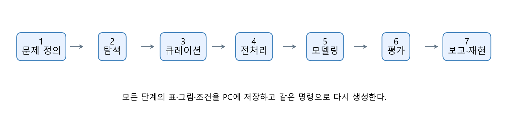

## 2. 탐색: 자료가 어떤 모습을 갖는가

2025년 1~6월 2,729개 대여소에서 유효 관측 11,700,878건을 확인한다. 현재·다음 관측이 모두 있는 행은 11,689,962건이며 다음 0대 비율은 9.73%로 확인한다.

1월 9~10일에는 전체 관측 누락을 확인한다. 이 날짜를 실제로 모든 대여소가 0대였다고 처리하지 않는다. 시간대별 전환 위험이 다른 것도 확인하며, 이 탐색 관계를 원인으로 단정하지 않는다.

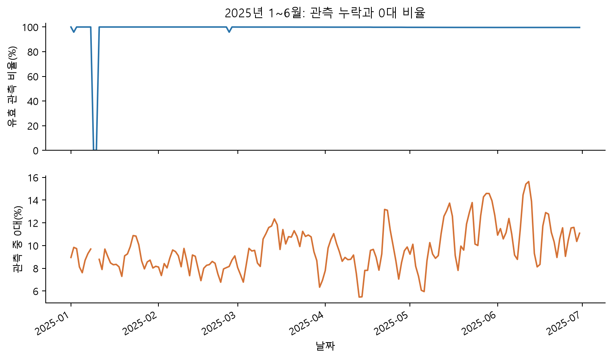

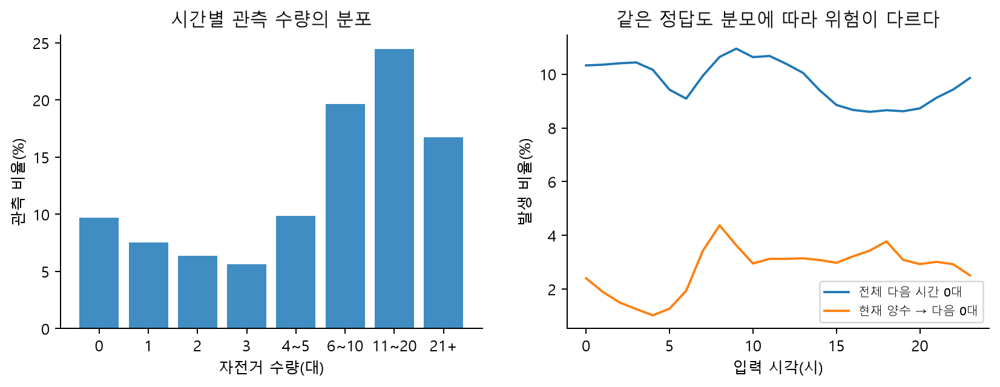

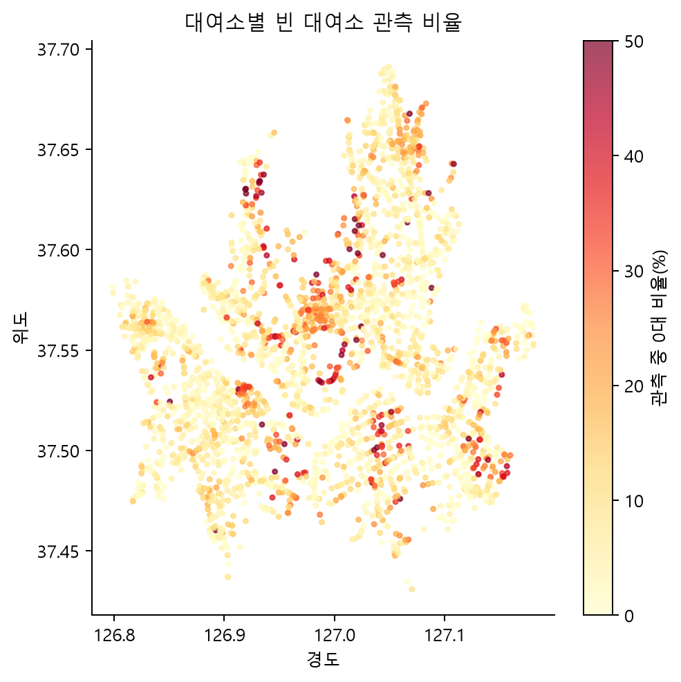

## 3. 큐레이션: 어떤 기록을 믿고 쓸 것인가

같은 대여소·시각에 같은 수량이 반복되면 한 관측으로 합친다. 서로 다른 수량이 충돌하면 자료 의미를 확인하기 전 해당 키 전체를 제외한다. 2024년에는 약 268만 충돌 키를 제외한다. 임의의 합계·평균·마지막 값을 선택하지 않는다.

기존 학습에서 정한 대여소와 2024-12 위치를 유지해 모델마다 다른 표본으로 비교하지 않는다. 새 대여소 일반화는 별도 과제로 남긴다. 모든 처리의 이유·조사 근거·검사·대안을 데이터처리_근거기록.md에 남긴다.

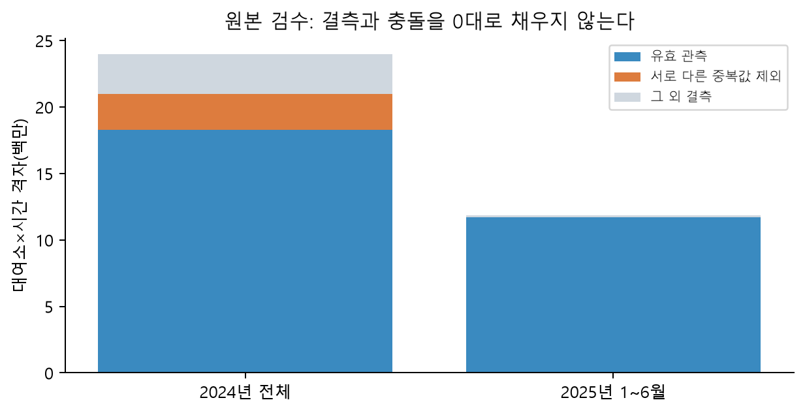

## 4. 전처리: 미래를 보지 않고 입력을 만든다

과거 수량·증감·지속 시간·주변 수량·과거 전환 빈도를 구성한다. 미래 값을 바꿔도 앞선 특징이 바뀌지 않는 검사와 청크 계산 동등성 검사를 수행한다. 결측과 실제 0대를 별도 마스크로 구분한다.

학습, 학습 종료 시점 선택, 확률 보정, 경보 기준 선택, 바깥 개발 검증을 시간 순서로 나눈다. 대치값·표준화는 학습에서만 적합한다. 3·4분기 성능은 아직 열지 않는다.

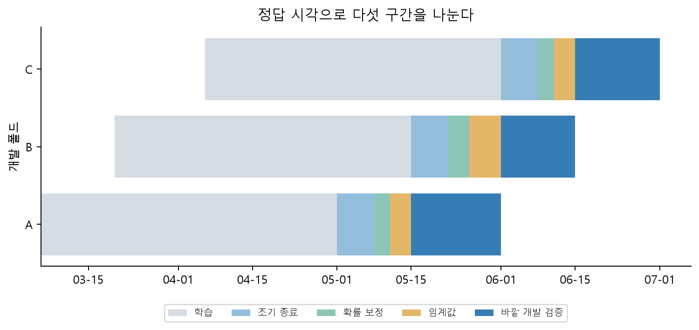

## 5. 모델링: 같은 문제를 여러 방법으로 푼다

상태 유지·계절 규칙·평활 Markov·선형·Random Forest·부스팅을 기준으로 비교한다. 시간 특징 73개를 동일하게 쓰는 LightGBM·CatBoost·XGBoost로 학습기 차이를 확인한다. 공간·전환 특징을 더한 비교는 정보 추가 효과를 포함한다.

학습 기간·최근성·공휴일·전년도·분포 가정·시간 입력 길이·이웃 신호를 별도로 비교한다. RF 50만, 선형 100만, 신경망 30만 학습 표본 제한을 기록한다. 같은 검증 전체 행을 평가하지만 동일한 계산 예산이라고 주장하지 않는다.

아래 표는 세 기간 모두 성공한 후보만 집계한다. 한 기간만 실행한 탐색 후보는 별도 그림과 상세 CSV에서 확인한다. 시간은 학습·보정·평가를 포함한 프로세스 경과시간으로 기록하며 PC 절전·대기 영향을 포함할 수 있어 순수 CPU 학습시간으로 해석하지 않는다.

| 후보 | 평균 F1(%) | 전환 재현율(%) | 전환 정밀도(%) | 학습·평가 합계(분) |
| --- | --- | --- | --- | --- |
| CatBoost | 73.389 | 23.61 | 44.04 | 175.4 |
| 기본 LightGBM | 72.667 | 19.71 | 41.57 | 10.9 |
| 공간·전환 LightGBM | 73.645 | 25.22 | 44.65 | 19.3 |
| 시간 특징 LightGBM | 73.158 | 21.93 | 43.37 | 23.1 |
| 선형 확률 모델 | 71.789 | 1.60 | 40.18 | 0.8 |
| 기존 결합 구조(기상 제외) | 73.831 | 25.41 | 45.72 | 0.9 |
| 현재 상태 유지 | 71.757 | 0.00 | 0.00 | 0.2 |
| Random Forest | 72.010 | 11.32 | 38.25 | 8.0 |
| 전일 규칙+상태별 판단 | 71.757 | 0.00 | 0.00 | 0.3 |
| 전주 규칙+상태별 판단 | 71.757 | 0.00 | 0.00 | 0.2 |
| 평활 전환 빈도 | 71.841 | 13.86 | 37.10 | 0.3 |
| XGBoost | 73.298 | 22.31 | 43.32 | 57.6 |

## 방법론 비교에서 확인한 의미

같은 LightGBM 설정에서 시간 특징 73개와 공간·전환 특징 105개를 비교하면 세 기간 평균 F1 차이를 +0.487%p로 확인한다. 입력 정보의 추가를 학습기 이름 변경과 구분한다.

고정 50:50 결합은 공간·전환 LightGBM보다 평균 F1 차이 +0.186%p를 기록한다. 결합 비율을 이 세 검증 성과에 맞춰 다시 조정하지 않는다.

A에서만 실행한 17개 예비 비교 중 전체 F1이 가장 높은 것은 학습 이력 112일로 확대이며 공간·전환 기준 대비 +0.159%p로 확인한다. 사전에 정한 +0.2%p 기준을 넘는 추가 확인 대상이 없어 B/C 조건부 추가 학습을 실시하지 않는다. 50:50 결합은 처음부터 세 기간 필수 대조군에 속하므로 이 예비 후보 선별과 구분한다.

신경망 5개 예비 비교는 A의 공간·전환 기준보다 -1.711~-1.174%p 낮은 F1을 기록한다. CPU·30만 학습 표본·최대 20회 학습이라는 이번 범위의 결과로 한정하며 모든 신경망이나 원논문보다 트리가 우월하다고 일반화하지 않는다.

## 시민이 고를 현재 양수 대여소를 따로 평가한다

현재 자전거가 있는 세 기간의 기록을 합산해 비교한다. 50:50 결합은 기본 LightGBM보다 새 0대 전환을 5,661건 더 찾지만, 같은 구간의 오경보도 2,454건 늘어난다. 전체 오경보 감소를 이 구간의 오경보 감소로 바꾸어 설명하지 않는다.

아래 재현율·정밀도는 세 구간의 오류 건수를 먼저 합친 뒤 계산한다. 앞 표의 기간별 비율 단순 평균과 분모가 다름을 명시한다. 전환 놓침이 여전히 많으며 실제 시민의 대여 성공·추가 이동 감소를 검증한 것은 아니다.

| 모델 | 전환 포착(건) | 전환 놓침(건) | 전환 오경보(건) | 합산 전환 재현율(%) | 합산 전환 정밀도(%) |
| --- | --- | --- | --- | --- | --- |
| 기본 LightGBM | 19661 | 79787 | 27550 | 19.77 | 41.64 |
| 공간·전환 LightGBM | 25305 | 74143 | 31454 | 25.45 | 44.58 |
| 기존 결합 구조(기상 제외) | 25322 | 74126 | 30004 | 25.46 | 45.77 |

## 6. 평가: 각 기준보다 얼마나 달라졌는가

같은 세 기간에서 기존 결합 구조(기상 제외)를 각 비교 기준과 대조한다. F1은 기간별 단순 평균이며 FP·FN은 세 구간 합계로 계산한다. FP·FN 차이에서 음수는 오류 감소를 의미한다.

단일 기간의 최고 점수를 최종 채택으로 바꾸지 않는다. A에서 기준보다 0.2%p 이상 높은 사전 지정 후보 중 최대 두 개를 B/C에서 확인하는 규칙을 기록한다. 예측 확률 품질(AP·Brier), 전환 재현율·정밀도, 현재 1~3대 구간도 원본 JSON에 보관한다.

더 많이 찾으면서 오경보가 늘 수 있다. 낮은 절대 재현율과 악화된 구간도 성과 옆에 제시한다. 최종 선택 후의 독립 검증과 운영 효과 검증은 현재 개발 비교와 구분한다.

| 비교 기준 | 기준 F1(%) | 현재 우세 후보 차이(%p) | 전체 FP 차이 | 전체 FN 차이 |
| --- | --- | --- | --- | --- |
| CatBoost | 73.389 | +0.442 | +370 | -2,744 |
| 기본 LightGBM | 72.667 | +1.164 | -9,002 | -1,524 |
| 공간·전환 LightGBM | 73.645 | +0.186 | -5,014 | +1,805 |
| 시간 특징 LightGBM | 73.158 | +0.673 | -3,064 | -2,026 |
| 선형 확률 모델 | 71.789 | +2.042 | +2,707 | -13,179 |
| 기존 결합 구조(기상 제외) | 73.831 | +0.000 | +0 | +0 |
| 현재 상태 유지 | 71.757 | +2.075 | +5,281 | -14,775 |
| Random Forest | 72.010 | +1.821 | -7,064 | -6,361 |
| 전일 규칙+상태별 판단 | 71.757 | +2.075 | +5,281 | -14,775 |
| 전주 규칙+상태별 판단 | 71.757 | +2.075 | +5,281 | -14,775 |
| 평활 전환 빈도 | 71.841 | +1.990 | -13,677 | -3,635 |
| XGBoost | 73.298 | +0.533 | -5,134 | -57 |

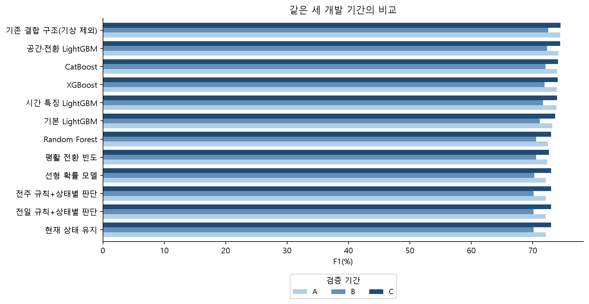

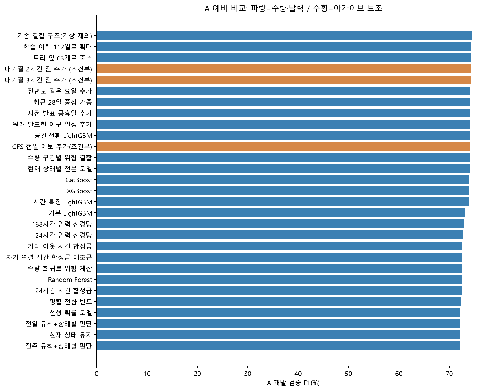

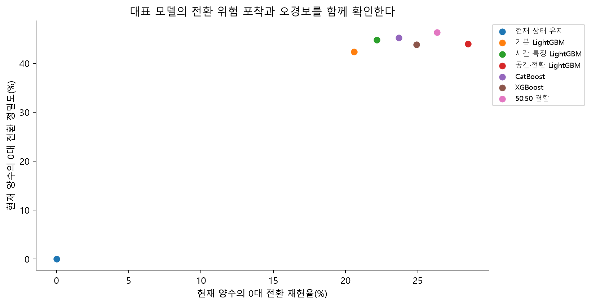

## 추가 AI의 현재 성과와 비용

완료한 기간만 아래 표에 싣는다. A는 5월 15~31일, B는 6월 1~14일, C는 6월 15~30일로 구분한다. 모든 차이는 같은 기간의 기본 LightGBM을 기준으로 계산한다.

전환 오경보 차이의 양수는 현재 자전거가 있는 대여소에 잘못 보낸 위험 경보가 늘었다는 뜻으로 설명한다. 전체 F1 향상과 시민이 선택할 양수 대여소의 오경보를 함께 읽는다. 각 모델의 입력 특징 수가 달라 학습기만 바꾼 효과로 단정하지 않는다.

| 기간 | 추가 후보 | 전체 F1(%) | 기본 대비 차이(%p) | 전환 재현율(%) | 전환 오경보 차이(건) |
| --- | --- | --- | --- | --- | --- |
| A | 공간·전환 LightGBM | 74.155 | +0.958 | 28.47 | +3,078 |
| A | CatBoost | 73.983 | +0.786 | 23.68 | +246 |
| A | XGBoost | 73.910 | +0.713 | 24.90 | +1,454 |
| A | 기존 결합 구조(기상 제외) | 74.448 | +1.251 | 26.33 | +927 |
| B | 공간·전환 LightGBM | 72.316 | +1.149 | 24.94 | +687 |
| B | CatBoost | 72.088 | +0.920 | 21.22 | -822 |
| B | XGBoost | 71.905 | +0.738 | 20.65 | -663 |
| B | 기존 결합 구조(기상 제외) | 72.529 | +1.362 | 24.89 | +265 |
| C | 공간·전환 LightGBM | 74.463 | +0.826 | 22.25 | +139 |
| C | CatBoost | 74.095 | +0.458 | 25.91 | +2,962 |
| C | XGBoost | 74.079 | +0.442 | 21.38 | +834 |
| C | 기존 결합 구조(기상 제외) | 74.516 | +0.880 | 25.00 | +1,262 |

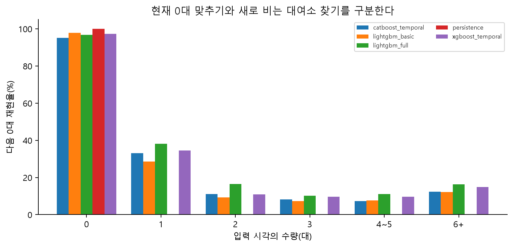

## 실제 관측 사례로 판정 차이를 확인한다

2025년 A 개발 기간에서 각 판정 유형의 첫 관측을 시간·고정 대여소 순서로 고른다. 좋은 사례와 불리한 사례, 두 모델이 함께 놓친 사례를 같은 기준으로 제시한다. 전체 A/B/C의 여섯 유형 사례와 건수는 CSV에 저장한다.

두 모델은 각각 앞선 정책 구간에서 고정한 경보 기준을 적용한다. 표는 다음 한 시간 격자의 관측 수량과 분류 경보를 비교하며 실제 시민의 대여 성공·실패나 이동 감소를 측정한 것으로 설명하지 않는다. 사례 수를 전체 성능의 분모로 사용하지 않는다.

[전체 판정 사례와 예측 확률](E2E/06_평가/기본과결합_판정사례.csv)

[선정한 유형별 전체 건수](E2E/06_평가/기본과결합_판정유형건수.csv)

| 판정 유형 | 입력 시각 | 대여소 | 현재→다음 수량 | 기본 경보 | 결합 경보 |
| --- | --- | --- | --- | --- | --- |
| 기본 놓침-결합 포착 | 2025-05-14 23:00 |  진미파라곤 앞 | 1→0 | 없음 | 있음 |
| 기본 포착-결합 놓침 | 2025-05-14 23:00 |  여의도중학교 옆 | 1→0 | 있음 | 없음 |
| 기본 정상-결합 오경보 | 2025-05-14 23:00 |  마스타 빌딩 앞 | 1→1 | 없음 | 있음 |
| 두 모델 모두 놓침 | 2025-05-14 23:00 |  서강대 후문 옆 | 1→0 | 없음 | 없음 |

## 날짜가 달라도 차이가 유지되는지 살펴본다

하루의 모든 대여소·시간을 함께 묶고 같은 날짜 묶음을 두 모델에 적용한다. 1일과 연속 7일 묶음을 각각 2,000회 다시 뽑아 차이의 변동을 확인한다. 표에는 7일 묶음의 결과를 싣고 그림에는 두 방식을 함께 표시한다.

이미 성과를 확인한 개발 기간의 탐색적 분석으로 사용한다. 짧은 기간·주간 묶음 수·여러 후보 선택·단일 초기값·학습 기간 중첩이 남아 있으므로 이 범위를 독립 최종 시험의 우월성 증명이나 보장된 95% 신뢰수준으로 바꾸지 않는다.

| 기간 | 추가 후보 | 전체 F1 차이(%p) | 7일 묶음 재표집 범위(%p) |
| --- | --- | --- | --- |
| A | CatBoost | +0.786 | +0.575 ~ +1.034 |
| A | 공간·전환 LightGBM | +0.958 | +0.746 ~ +1.199 |
| A | 기존 결합 구조(기상 제외) | +1.251 | +1.078 ~ +1.467 |
| A | XGBoost | +0.713 | +0.532 ~ +0.857 |
| B | CatBoost | +0.920 | +0.739 ~ +1.053 |
| B | 공간·전환 LightGBM | +1.149 | +0.971 ~ +1.289 |
| B | 기존 결합 구조(기상 제외) | +1.362 | +1.128 ~ +1.534 |
| B | XGBoost | +0.738 | +0.415 ~ +1.011 |
| C | CatBoost | +0.458 | +0.091 ~ +0.614 |
| C | 공간·전환 LightGBM | +0.826 | +0.646 ~ +0.961 |
| C | 기존 결합 구조(기상 제외) | +0.880 | +0.521 ~ +1.046 |
| C | XGBoost | +0.442 | +0.174 ~ +0.509 |

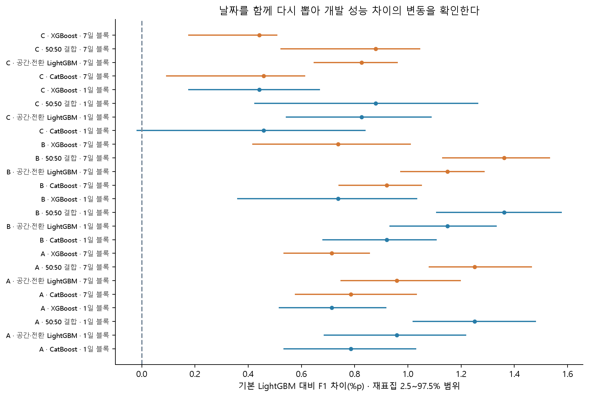

## 예측 확률이 실제 위험과 얼마나 맞는지 확인한다

예측 위험이 비슷한 기록을 10개 확률 구간으로 묶고 평균 예측값과 실제 0대 비율을 비교한다. 대각선에 가까울수록 이 구간의 확률과 관측 비율이 비슷함을 뜻한다. 빈 구간은 실제 위험 0%로 바꾸지 않으며 구간별 표본 수를 CSV에 저장한다.

모델·기간·기록 범위 조합 18개 중 10개에서는 확률 보정 뒤 Brier가 증가한다. 보정을 수행했다는 사실을 확률 품질이 항상 좋아졌다는 주장으로 바꾸지 않는다. 아래 수치는 기간별 점수의 단순 평균이며 Brier는 확률의 제곱 오차로 설명한다.

낮은 Brier는 확률 보정과 구분 능력을 함께 반영하므로 보정의 정확성만 증명하지 않는다. 이미 확인한 개발 기간의 사후 진단이며 이 정답으로 모델·보정기·임계값을 다시 맞추지 않는다. 미래 운영에서 같은 확률 품질이 유지된다는 보장으로 해석하지 않는다.

| 모델 | 기록 범위 | 보정 전 평균 Brier | 보정 후 평균 Brier | 차이(낮을수록 개선) |
| --- | --- | --- | --- | --- |
| 기존 결합 구조(기상 제외) | 현재 양수 | 0.02750 | 0.02752 | +0.00003 |
| 기존 결합 구조(기상 제외) | 전체 | 0.04251 | 0.04255 | +0.00004 |
| 기본 LightGBM | 현재 양수 | 0.02872 | 0.02879 | +0.00007 |
| 기본 LightGBM | 전체 | 0.04447 | 0.04457 | +0.00010 |
| 공간·전환 LightGBM | 현재 양수 | 0.02776 | 0.02782 | +0.00006 |
| 공간·전환 LightGBM | 전체 | 0.04283 | 0.04291 | +0.00009 |

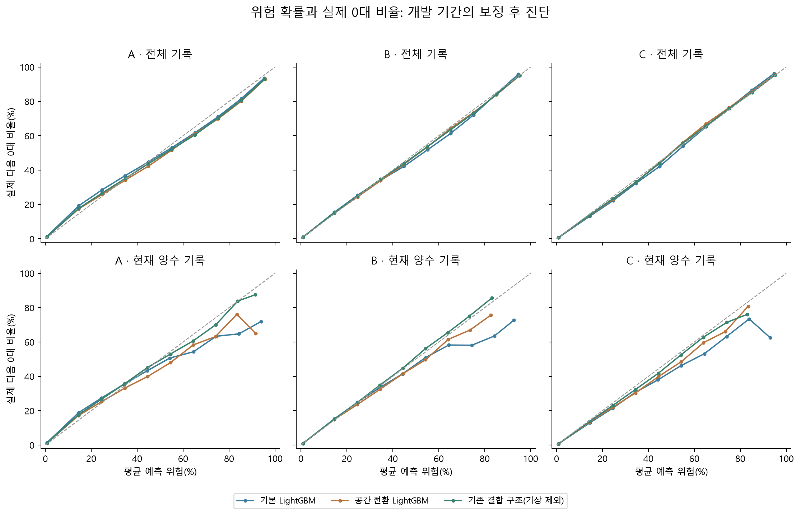

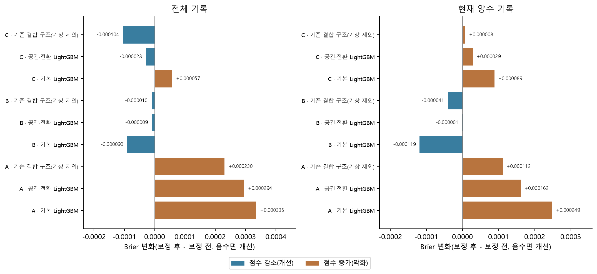

## 추가 데이터: 실제로 제때 받을 수 있는가

실시간 따릉이 조회에서 2,716개 대여소와 기존 코호트 2,618개의 연결을 확인한다. API에 공급자 관측 시각이 없어 수신 시각을 측정 시각으로 꾸미지 않는다. 과거 시간 격자와 현재 API의 동등성·지연은 추가 운영 검증으로 남긴다.

서울 대기질은 과거 상반기 108,600행과 현재 25개 구 API 연결을 확보한다. 한 번의 응답에서 관측→수신 약 60분 차이를 확인한다. 현재 3개 구의 점검중 수치를 결측으로 거부한다. 수신≤입력, 관측≤입력-2/3시간, 자료 나이·QC 규칙을 코드로 검사한다. 대기질 추가 비교 2건의 실제 결과를 상세 표에 기록한다. 역사 수신 이력 미상이라는 조건을 붙여 해석한다.

역사 자료의 공개·수정·수신 이력은 입증하지 못했으므로 단지 시차를 줬다는 이유로 실제 과거 실시간 성능이라고 부르지 않는다. 24시간 전 자료를 쓰려면 실시간 스냅샷 캐시가 필요하다.

GFS 전일 예보 상품은 미래 유효 시각의 현재 수신 경로와 현재 실행의 게시 메타데이터를 확인한다. day1 표기를 행마다 정확히 24시간 전 발표했다는 의미로 해석하지 않는다. 과거 실행별 발표·수신 시각은 미검증이므로 별도 조건부 비교로 진행한다. 문화행사 19,642건과 KOPIS 부분 목록 3,273개를 확보하며, 수정 이력·좌표·서버 차단 조건이 남은 자료는 주 입력에 자동 채택하지 않는다. 추가 키가 필요한 기상청 자료의 발급 대상과 필요성을 별도 조사 보고서에 기록한다.

## 추가 공공데이터를 넓게 조사한다

세 조사 작업으로 교통·이동 24개, 공간·시설 19개, 인구·행사 19개로 총 62개 후보를 정리한다. 기존 원천의 재검토와 부적합 후보도 포함하며 모두 새 독립 원천으로 세지 않는다.

후보마다 영향 가설, 공식 출처, 과거 이력, 공개 지연, 대여소 연결, 이용조건, 필요한 키와 다음 검수를 기록한다. 실시간으로 조회되는 자료와 과거 검증 기간에 사용할 수 있는 자료를 구분한다.

버스정류소 위치는 고정 2,729개 대여소의 거리와 반경별 정류소 수를 구성하고 별도 거리 계산으로 대조한다. 과거 최초 공개·수신 미검증 조건은 유지한다. 실시간 주차·지하철은 현재 응답만으로 2025년 이력을 만들지 않는다.

[62개 후보를 검색하는 통합보고서](../20261020_공공데이터추가조사2/공공데이터_추가조사_통합보고서.html)

[전체 후보 CSV](../20261020_공공데이터추가조사2/통합후보목록.csv)

## 새 자료를 실제 입력으로 준비한다

2024년 11월 대여·반납 집계의 일파일 30개, 수록 6,364,061행을 전수 검수한다. 출발시간과 도착시간 기준을 따로 집계하며 같은 이동을 두 번 더하지 않는다. 행이 없는 시간의 이용을 실제 0으로 확정하지 않고 수록 일수와 결측을 보존한다.

현재 번호·이름·50m 위치 조건을 충족하고 과거 흐름에 ID가 있는 대여소 2,493곳을 조건부 연결한다. 고정 코호트 2,729곳을 유지하며 미연결 입력을 결측으로 남긴다. 현재 교차표가 과거 ST-ID 동일성을 입증하지는 않는다.

선행 흐름 프로필과 이동 관계의 정제본을 저장한다. 처리 근거와 검수는 모델 학습 전에 남기며, 이 준비만으로 추가 자료의 성능 개선을 확인한 것으로 표현하지 않는다. v4 고정 실험과 구분한 후속 비교로 검토한다.

[추가 자료 준비와 품질 검수 설명](../20261020_추가공공데이터적용/데이터준비_쉬운설명.html)

[추가 입력의 정의와 처리 근거](../20261020_추가공공데이터적용/특징정의와근거.md)

## 추가 공공데이터를 붙여 따로 비교한다

추가 자료 비교 9/9개의 계산을 검수한다. 버스정류소 4개, 선행 흐름 7개, 결합 11개를 같은 105개 특징 모델에 각각 더한다. 같은 A/B/C에서 비교하며 v4 학습이 끝난 뒤 한 번에 하나씩 실행한다.

모형 재로딩과 저장 확률, 전체 오류 건수, 각 기준 모델 대비 차이, 날짜별 변동을 확인한다. 역사 수신·과거 ID·원천 날짜 의미의 미검증이 남으므로 이 추가 자료의 결과를 주 운영 우세 모델로 자동 채택하지 않는다.

표가 있는 경우 F1과 재현율 차이는 세 기간 단순 평균, 오경보 차이는 세 구간 합계로 계산한다. 자세한 기간별 성과와 불리한 결과도 별도 보고서에서 함께 확인한다.

[추가 공공데이터 모델 비교보고서](../20261020_추가공공데이터적용/추가공공데이터_비교보고서.html)

| 추가 자료 | 세 기간 평균 F1(%) | 공간·전환 기준 대비(%p) | 전환 재현율 차이(%p) | 전환 오경보 차이 합계 |
| --- | --- | --- | --- | --- |
| 버스정류소 추가 | 73.645 | +0.000 | +0.00 | +0 |
| 버스·선행 흐름 결합 | 73.683 | +0.038 | +0.98 | +1,204 |
| 선행 대여·반납 추가 | 73.683 | +0.038 | +0.98 | +1,204 |

## 추가 자료의 채택 판단

버스정류소 특징의 공간·전환 기준 대비 평균 F1 변화는 +0.0000%p로 확인한다. 이번 특징과 모형 설정에서 얻은 결과로 한정하며 버스 이용과 따릉이가 무관하다고 일반화하지 않는다.

선행 대여·반납 특징의 평균 F1 변화는 공간·전환 기준 대비 +0.0378%p이며, 현재 주 비교의 결합 모델 대비 -0.1485%p로 확인한다. 평균 변화만으로 채택하지 않고 기간별 악화와 전환 오경보, 역사 연결 조건을 함께 판단한다.

현재 다음 검증의 우선 후보는 기존 50:50 결합으로 유지한다. 추가 자료와 더 긴 학습 창은 재검토 후보로 보존한다. 기상청 발표본·교통량·생활인구 프로필은 공개 시점과 인증·품질을 먼저 확인할 후속 후보로 정리하며, 이번에 모두 학습했다고 표현하지 않는다.

새 운영 자료로 검증할 때는 원천 측정·발표·수신 시각과 버전을 함께 쌓는다. 3·4분기 자료는 새 선택 절차를 고정한 뒤 다룰 후속 검증으로 남기며 이번 개발 비교의 독립 시험으로 주장하지 않는다.

## 7. 보고·재현: 어디에서 다시 확인하는가

이 보고서, 단계별 CSV·JSON·PNG·SVG, 학습 설정, 모델·예측·보정기, 처리 근거, 검수 기록을 PC에 저장한다. 큰 원본과 모델은 원래 위치를 유지하고 코드·분석 기록을 별도 압축한다. 키는 로컬 .env에서만 읽고 압축·보고서에서 제외한다.

leaderboard.csv에서 전체 수치를 확인하고 E2E/06_평가/각베이스라인대비변화.csv에서 후보별 차이를 확인한다. 데이터처리_근거기록.md, 추가데이터_병렬조사/보고서와재개방법.md, roundtrip_checks.json, tests_latest.json으로 근거와 검사를 추적한다.

재개.ps1은 완료 후보를 건너뛰며 미완료 후보를 이어간다. 최종 결과 해석은 개발 기간의 선택 편향, 단일 초기값, 입력 제공 지연, 실제 대여 성공을 측정하지 않았다는 한계를 포함한다.
